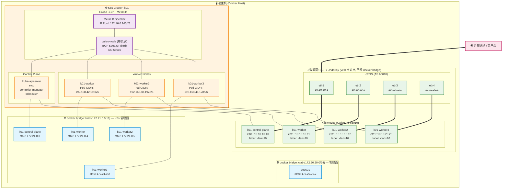
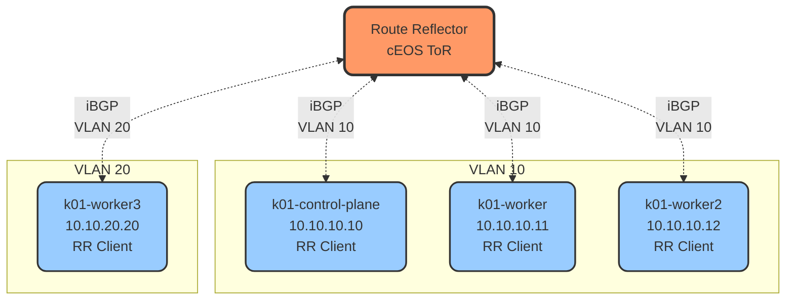
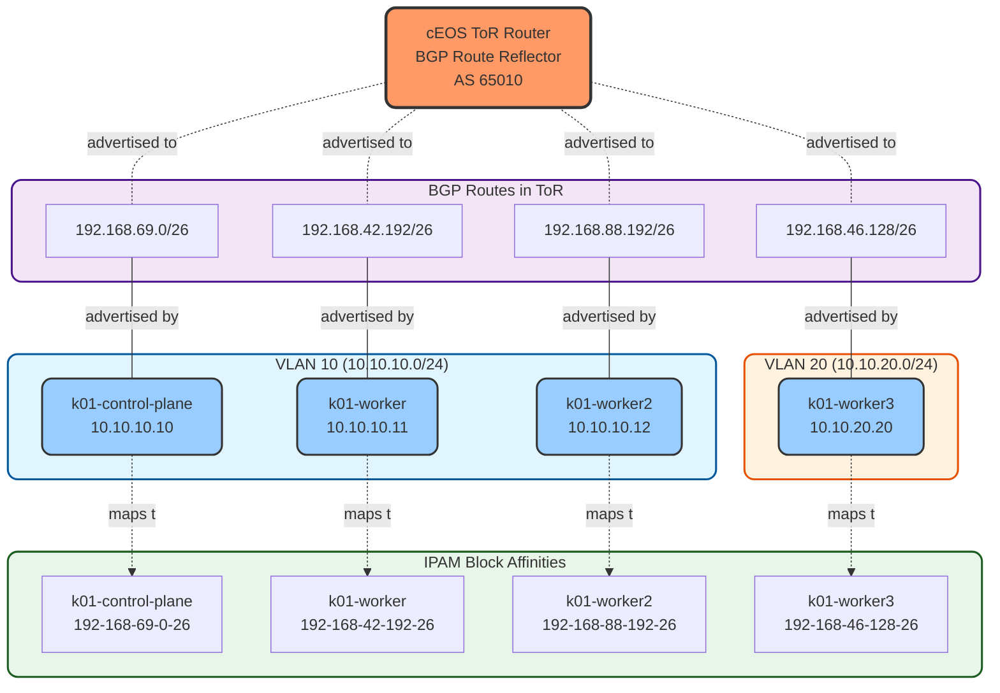
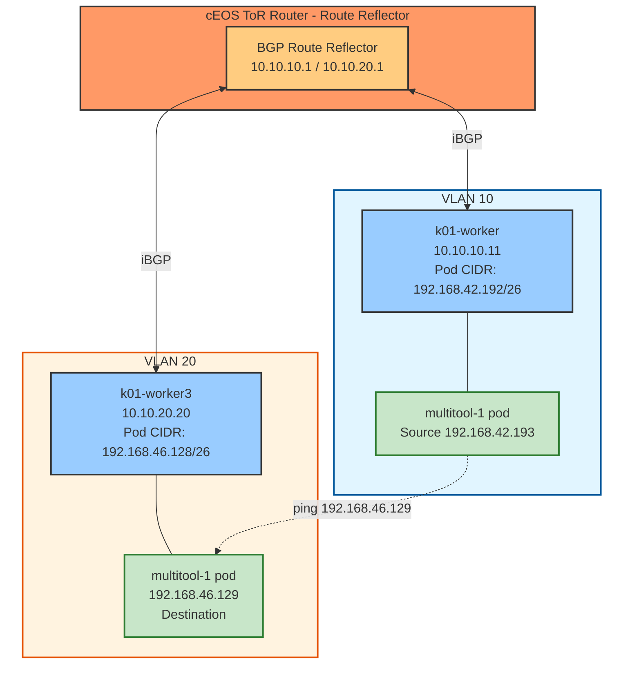
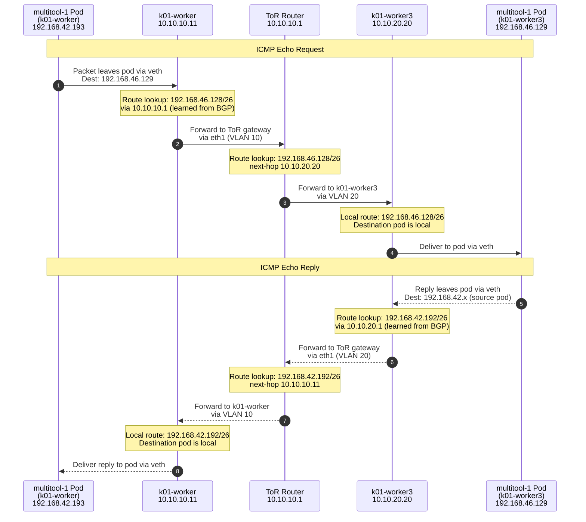

本节主要实现，使用BGP将Calico IP地址池通告给外部网络，使得Pod IP地址能够在kubernetes集群外进行访问
## 资源清单


### 网络topo

```yaml
name: calico-bgp-lb
topology:
  nodes:
    ceos01:
      kind: arista_ceos
      image: ceos:4.34.0F
      startup-config: startup-configs/ceos01-startup-config.config
    k01:
      kind: k8s-kind
      startup-config: k01-no-cni.yaml
      extras:
        k8s_kind:
          deploy:
            wait: 0s

    k01-control-plane:
      kind: ext-container
      exec:
      # 将 eth1 的 MTU设置为 9000
        - "ip link set dev eth1 mtu 9000"
      # 给eth1 配置 IP 地址
        - "ip addr add dev eth1 10.10.10.10/24"
        - "ip route add 10.10.20.0/24 via 10.10.10.1 src 10.10.10.10"

    k01-worker:
      kind: ext-container
      exec:
        - "ip link set dev eth1 mtu 9000"
        - "ip addr add dev eth1 10.10.10.11/24"
        - "ip route add 10.10.20.0/24 via 10.10.10.1 src 10.10.10.11"


    k01-worker2:
      kind: ext-container
      exec:
        - "ip link set dev eth1 mtu 9000"
        - "ip addr add dev eth1 10.10.10.12/24"
        - "ip route add 10.10.20.0/24 via 10.10.10.1 src 10.10.10.12"

    k01-worker3:
      kind: ext-container
      exec:
        - "ip link set dev eth1 mtu 9000"
        - "ip addr add dev eth1 10.10.20.20/24"
        - "ip route add 10.10.10.0/24 via 10.10.20.1 src 10.10.20.20"

  links:
    - endpoints: ["ceos01:eth1", "k01-control-plane:eth1"]
    - endpoints: ["ceos01:eth2", "k01-worker:eth1"]
    - endpoints: ["ceos01:eth3", "k01-worker2:eth1"]
    - endpoints: ["ceos01:eth4", "k01-worker3:eth1"]
```




### cEOS配置

```bash
! Arista cEOS startup configuration
!
hostname ceos
!
! Define VLAN 10
!
vlan 10
   name Calico-Network
!
! Define VLAN 20
!
vlan 20
   name Calico-Network-2
!
! Configure interfaces as access ports in VLAN 10
!
interface Ethernet1
   description Connection to k01-control-plane
   mtu 9124
   switchport mode access
   switchport access vlan 10
!
interface Ethernet2
   description Connection to k01-worker
   mtu 9124
   switchport mode access
   switchport access vlan 10
!
interface Ethernet3
   description Connection to k01-worker2
   mtu 9124
   switchport mode access
   switchport access vlan 10

interface Ethernet4
   description Connection to k01-worker3
   mtu 9124
   switchport mode access
   switchport access vlan 20

!
! Layer 3 interface for VLAN 10
!
interface Vlan10
   description Calico Network L3 Interface
   mtu 9124
   ip address 10.10.10.1/24

interface Vlan20
   description Calico Network L3 Interface
   mtu 9124
   ip address 10.10.20.1/24
!
! Enable IP routing
!
ip routing
!
! Management interface
!
interface Management0
   ip address dhcp
   no shutdown
!
! User configuration
!
username admin privilege 15 secret admin
!
! Enable HTTP API
!
management api http-commands
   no shutdown
! 这里AS 为 65010 因此和 node 建立的为iBGP对等体
router bgp 65010
   router-id 10.10.10.1
   neighbor CALICO-K8S peer group
   neighbor CALICO-K8S description "Calico Kubernetes Nodes"
   neighbor CALICO-K8S route-reflector-client
   bgp listen range 10.10.10.0/24 peer-group CALICO-K8S remote-as 65010
   bgp listen range 10.10.20.0/24 peer-group CALICO-K8S remote-as 65010
   neighbor CALICO-K8S next-hop-self
   !
   address-family ipv4
      neighbor CALICO-K8S activate
      network 10.10.10.0/24
      network 10.10.20.0/24

end
```

### kind cluster配置

```yaml
apiVersion: kind.x-k8s.io/v1alpha4
kind: Cluster
name: k01
networking:
# 禁止使用k8s默认的CNI kindnet
  disableDefaultCNI: true
# calico 的 cluster CIDR 会继承这个值
# calico 的BGP 会将这个网段通告给cEOS
  podSubnet: "192.168.0.0/16"
  serviceSubnet: "10.96.0.0/16"
nodes:
  - role: control-plane
    kubeadmConfigPatches:
      - |
        kind: InitConfiguration
        nodeRegistration:
          kubeletExtraArgs:
            node-ip: "10.10.10.10"
            node-labels: "vlan=10"
      - |
        kind: ClusterConfiguration
        apiServer:
          certSANs:
            - "127.0.0.1"
# 支持从外部访问 apiserver
            - "10.10.10.10"
          extraArgs:
            advertise-address: "10.10.10.10"

  - role: worker
    kubeadmConfigPatches:
      - |
        kind: JoinConfiguration
        nodeRegistration:
          kubeletExtraArgs:
            node-ip: "10.10.10.11"
            node-labels: "vlan=10"

  - role: worker
    kubeadmConfigPatches:
      - |
        kind: JoinConfiguration
        nodeRegistration:
          kubeletExtraArgs:
            node-ip: "10.10.10.12"
            node-labels: "vlan=10"

  - role: worker
    kubeadmConfigPatches:
      - |
        kind: JoinConfiguration
        nodeRegistration:
          kubeletExtraArgs:
            node-ip: "10.10.20.20"
            node-labels: "vlan=20"
```

### Calico 配置

安装calico的基础配置

```yaml
# This section includes base Calico installation configuration.
# For more information, see: https://docs.tigera.io/calico/latest/reference/installation/api#operator.tigera.io/v1.Installation
apiVersion: operator.tigera.io/v1
kind: Installation
metadata:
  name: default
spec:
  # Configures Calico networking.
  calicoNetwork:
    ipPools:
    - name: default-ipv4-ippool
      # `blockSize` ：每个节点分配的 IP 块大小（26 位＝每个块 64 个 IP 地址）
      blockSize: 26
      # Pod 网络使用的IP地址范围
      cidr: 192.168.0.0/17
      # 隧道模式，None表示不使用叠加网络，使用原生网络
      encapsulation: None
      # 负责控制从集群中输出的流量进行NAT处理，Disabled 表示没有NAT处理
      natOutgoing: Disabled
      nodeSelector: all()
      # 是否禁止使用BGP告知这个IP池，false表示允许告知
      disableBGPExport: false
    nodeAddressAutodetectionV4:
      cidrs:
        - 10.10.0.0/16

---

# This section configures the Calico API server.
# For more information, see: https://docs.tigera.io/calico/latest/reference/installation/api#operator.tigera.io/v1.APIServer
apiVersion: operator.tigera.io/v1
kind: APIServer
metadata:
  name: default
spec: {}
```

BGP配置，用来配置BGP基础信息，以及要宣告的地址段信息

```yaml
apiVersion: crd.projectcalico.org/v1
kind: BGPConfiguration
metadata:
# **必须叫 `default`**，Calico 只认这个名字作为全局 BGP 配置
  name: default
spec:
  logSeverityScreen: Info
  asNumber: 65010
  # 关闭全mesh,这样node与node之间不在建立BGP通信，所有节点都和外部peer(cEOS)建立BGP
  # 这是标准的生产topo模式(route reflector 或 ToR模式)
  # 有助于减少 BGP session数量， N节点从 Nx(N-1)/2 降低到N
  nodeToNodeMeshEnabled: false
  serviceLoadBalancerIPs:
  - cidr: 172.16.0.240/28
# 添加之后，Calico就不会通告整个 CIDR  192.168.0.0/16 , 只会通告声明的这部分
  prefixAdvertisements:
  - cidr: 192.168.0.0/17
#  BGP 扩展属性
    communities:
    - 65010:100
```

BGP peer配置
```yaml
apiVersion: crd.projectcalico.org/v1
kind: BGPPeer
metadata:
  name: bgppeer-vlan-10
spec:
  peerIP: 10.10.10.1           # IP address of your Arista switch
  asNumber: 65010             # AS number of the Arista switch
  # 增加 nodeSelector，保证这个作用只下发到有对应label的node上
  nodeSelector: vlan == '10'  
```

```yaml
apiVersion: crd.projectcalico.org/v1
kind: BGPPeer
metadata:
  name: bgppeer-vlan-20
spec:
  peerIP: 10.10.20.1           # IP address of your Arista switch
  asNumber: 65010             # AS number of the Arista switch
  nodeSelector: vlan == '20'  # Apply to nodes with label vlan=20
```

ip pool 配置
```yaml
apiVersion: projectcalico.org/v3
kind: IPPool
metadata:
 name: loadbalancer-ip-pool
spec:
 cidr: 172.16.0.240/28
 blockSize: 28
 natOutgoing: true
 disabled: false
 assignmentMode: Automatic
 allowedUses:
  - LoadBalancer
```


## 环境检查
```bash
> containerlab inspect -t topology.clab.yaml
09:51:48 INFO Parsing & checking topology file=topology.clab.yaml
╭───────────────────────────┬──────────────────────┬─────────┬───────────────────────╮
│            Name           │      Kind/Image      │  State  │     IPv4/6 Address    │
├───────────────────────────┼──────────────────────┼─────────┼───────────────────────┤
│ k01-control-plane         │ ext-container        │ running │ 172.21.0.3            │
│                           │ kindest/node:v1.35.0 │         │ fc00:f853:ccd:e793::3 │
├───────────────────────────┼──────────────────────┼─────────┼───────────────────────┤
│ k01-worker                │ ext-container        │ running │ 172.21.0.4            │
│                           │ kindest/node:v1.35.0 │         │ fc00:f853:ccd:e793::4 │
├───────────────────────────┼──────────────────────┼─────────┼───────────────────────┤
│ k01-worker2               │ ext-container        │ running │ 172.21.0.5            │
│                           │ kindest/node:v1.35.0 │         │ fc00:f853:ccd:e793::5 │
├───────────────────────────┼──────────────────────┼─────────┼───────────────────────┤
│ k01-worker3               │ ext-container        │ running │ 172.21.0.2            │
│                           │ kindest/node:v1.35.0 │         │ fc00:f853:ccd:e793::2 │
├───────────────────────────┼──────────────────────┼─────────┼───────────────────────┤
│ clab-calico-bgp-lb-ceos01 │ arista_ceos          │ running │ 172.20.20.2           │
│                           │ ceos:4.34.0F         │         │ 3fff:172:20:20::2     │
├───────────────────────────┼──────────────────────┼─────────┼───────────────────────┤
│ k01-control-plane         │ k8s-kind             │ running │ 172.21.0.3            │
│                           │ kindest/node:v1.35.0 │         │ fc00:f853:ccd:e793::3 │
├───────────────────────────┼──────────────────────┼─────────┼───────────────────────┤
│ k01-worker                │ k8s-kind             │ running │ 172.21.0.4            │
│                           │ kindest/node:v1.35.0 │         │ fc00:f853:ccd:e793::4 │
├───────────────────────────┼──────────────────────┼─────────┼───────────────────────┤
│ k01-worker2               │ k8s-kind             │ running │ 172.21.0.5            │
│                           │ kindest/node:v1.35.0 │         │ fc00:f853:ccd:e793::5 │
├───────────────────────────┼──────────────────────┼─────────┼───────────────────────┤
│ k01-worker3               │ k8s-kind             │ running │ 172.21.0.2            │
│                           │ kindest/node:v1.35.0 │         │ fc00:f853:ccd:e793::2 │
╰───────────────────────────┴──────────────────────┴─────────┴───────────────────────╯    
```


## 检查IP地址池是否已经全部生效
```bash
> kubectl get ippools
NAME                   CREATED AT
default-ipv4-ippool    2026-10-10T09:14:31Z
loadbalancer-ip-pool   2026-10-10T09:17:35Z
```

### 验证IPAM块之间的关联性(block affinities)
块级关联(block affinities)指的是节点与从IP池中划分出的CIDR块之间的绑定关系。默认情况下，每个节点都会被分配一个属于自己的 `/26` 位制的块，这样就能确保节点内的IP地址具有高度局部性，从而实现高级的路由聚合。
```bash
> kubectl get blockaffinities
NAME                                CREATED AT
k01-control-plane-192-168-69-0-26   2026-10-10T09:15:18Z
k01-worker-192-168-42-192-26        2026-10-10T09:15:39Z
k01-worker2-192-168-88-192-26       2026-10-10T09:15:23Z
k01-worker3-192-168-46-128-26       2026-10-10T09:15:25Z
load-balancer-172-16-0-240-28       2026-10-10T09:17:35Z
```

## 验证BGP配置是否正确
![[Pasted image 20261012101423.png]]

### 验证 `bgpconfiguration` 资源
```yaml
> kubectl get bgpconfigurations -o yaml
apiVersion: v1
items:
- apiVersion: projectcalico.org/v3
  kind: BGPConfiguration
  metadata:
    name: default
  spec:
    asNumber: 65010
    logSeverityScreen: Info
    nodeToNodeMeshEnabled: false
    # 定义哪些网络前缀会通过BGP协议通告给外部网络BGP对等体
    prefixAdvertisements:
    - cidr: 192.168.0.0/17
      # 该前缀 附加BGP社区标签，用于通告BGP路由信息
      # communities 在BGP对等体之间，被用于路由过滤以及策略决策的制定
      # 格式AS:value 
      # 可以被上游路由器使用，以便对这些特定路由信息进行特定的路由策略
      # 能够实现对路由传播和流量工程的精细控制 
      communities:
      - 65010:100
    serviceLoadBalancerIPs:
    - cidr: 172.16.0.240/28
kind: List
metadata:
  resourceVersion: ""
```

### 验证BGP对等体状态
BGP 对等体资源用于创建从 Kubernetes 集群到上游网络的 BGP 对等。
- control, worker1和worker2的BGP对等体位于子网或者vlan10 中 
- worker3的BGP对等体位于vlan20中
之所以有两个BGP对等体，是因为在我们这个topo中的两个vlan里，机架顶部(topo of rack, ToR)交换机或BGP对等体IP是不同的。
```bash
> kubectl get bgppeers
NAME              CREATED AT
bgppeer-vlan-10   2026-10-10T09:17:34Z
bgppeer-vlan-20   2026-10-10T09:17:35Z
```

现在，我们来详细分析每个BGP peer的配置情况
```yaml
> kubectl get bgppeers bgppeer-vlan-10 -o yaml
apiVersion: projectcalico.org/v3
kind: BGPPeer
metadata:
  name: bgppeer-vlan-10
spec:
# 对等体自治系统编号，这里和node本身的一致，因此建立的是iBGP对等体
  asNumber: 65010
  # 该BGP对等体仅适用于带有标签 vlan==10的节点 (control-plane, worker, worker2)
  nodeSelector: vlan == '10'
  # vlan10 中BGP对端的IP地址，路由器/交换机
  peerIP: 10.10.10.1
```

```yaml
> kubectl get bgppeers bgppeer-vlan-20 -o yaml
apiVersion: projectcalico.org/v3
kind: BGPPeer
metadata:
  name: bgppeer-vlan-20
spec:
  asNumber: 65010
  nodeSelector: vlan == '20'
  peerIP: 10.10.20.1
```

### 检查ToR中的BGP配置是否正确
Arista cEOS路由器的BGP配置可以在启动文件 `ceos-startup-config.config` 中找到
```bash
> docker exec -it clab-calico-bgp-lb-ceos01 Cli
ceos>enable
ceos#show running-config | s bgp 
# 配置BGP, 使用AS号码 65010 与 calico的AS号相同
router bgp 65010
# 设置BGP路由ID
   router-id 10.10.10.1
   # 启用监听   动态接受来自：的 BGP 连接。 两个网段都要监听
   # 控制平面子网
   bgp listen range 10.10.10.0/24 peer-group CALICO-K8S remote-as 65010
   # 工作节点子网
   bgp listen range 10.10.20.0/24 peer-group CALICO-K8S remote-as 65010
   #  为calico 节点定义一个对等组
   neighbor CALICO-K8S peer group
   # 该路由宣称自己是反射路由的下一跳节点
   neighbor CALICO-K8S next-hop-self
   neighbor CALICO-K8S description "Calico Kubernetes Nodes"
   # 将邻居节点标记为路由反射客户端（无需实现完全的网络topo结构）(avoids full mesh requirement)
   neighbor CALICO-K8S route-reflector-client
   !
   address-family ipv4
      neighbor CALICO-K8S activate
      network 10.10.10.0/24
      network 10.10.20.0/24
ceos#
```


### 验证ToR中的BGP状态

查看ToR中BGP对等体连接状态

```bash
> docker exec -it clab-calico-bgp-lb-ceos01 Cli
ceos>enable
ceos#show ip bgp summary 
BGP summary information for VRF default
Router identifier 10.10.10.1, local AS number 65010
Neighbor Status Codes: m - Under maintenance
  Description              Neighbor    V AS           MsgRcvd   MsgSent  InQ OutQ  Up/Down State   PfxRcd PfxAcc
  "Calico Kubernetes Nodes 10.10.10.10 4 65010           3022      3105    0    0    1d20h Estab   2      2
  "Calico Kubernetes Nodes 10.10.10.11 4 65010           3030      3104    0    0    1d20h Estab   2      2
  "Calico Kubernetes Nodes 10.10.10.12 4 65010           3020      3108    0    0    1d20h Estab   2      2
  "Calico Kubernetes Nodes 10.10.20.20 4 65010           3020      3111    0    0    1d20h Estab   2      2
```
从BGP汇总结果来看，ToR路由器与Calico节点之间建立了四个BGP对等体会话
- `10.10.10.10` k01-control-plane (vlan 10)
- `10.10.10.11` k01-worker vlan 10
- `10.10.10.12` k01-worker02 vlan10
- `10.10.20.20` k01-worker03 vlan 20

每个BGP peer 都从路由反射客户端接收了两个 PfxRcd



接下来，我们看下ToR通过BGP学习的路由表
```bash
ceos#show ip route 

VRF: default
Source Codes:
       C - connected, S - static, K - kernel,
       O - OSPF, O IA - OSPF inter area, O E1 - OSPF external type 1,
       O E2 - OSPF external type 2, O N1 - OSPF NSSA external type 1,
       O N2 - OSPF NSSA external type2, O3 - OSPFv3,
       O3 IA - OSPFv3 inter area, O3 E1 - OSPFv3 external type 1,
       O3 E2 - OSPFv3 external type 2,
       O3 N1 - OSPFv3 NSSA external type 1,
       O3 N2 - OSPFv3 NSSA external type2, B - Other BGP Routes,
       B I - iBGP, B E - eBGP, R - RIP, I L1 - IS-IS level 1,
       I L2 - IS-IS level 2, A B - BGP Aggregate,
       A O - OSPF Summary, NG - Nexthop Group Static Route,
       V - VXLAN Control Service, M - Martian,
       DH - DHCP client installed default route,
       DP - Dynamic Policy Route, L - VRF Leaked,
       G  - gRIBI, RC - Route Cache Route,
       CL - CBF Leaked Route

Gateway of last resort is not set

 C        10.10.10.0/24
           directly connected, Vlan10
 C        10.10.20.0/24
           directly connected, Vlan20
# load-balancer
 B I      172.16.0.240/28 [200/0]
           via 10.10.10.10, Vlan10
 C        172.20.20.0/24
           directly connected, Management0
# k01-worker 10.10.10.11 的Pod CIDR块
 B I      192.168.42.192/26 [200/0]
           via 10.10.10.11, Vlan10
# k03-worker 10.10.20.20 的Pod CIDR块
 B I      192.168.46.128/26 [200/0]
           via 10.10.20.20, Vlan20
# k01-control-plane 的 CIDR 块，地址为 10.10.10.10
 B I      192.168.69.0/26 [200/0]
           via 10.10.10.10, Vlan10
# k01-worker2 的 Pod CIDR 块（10.10.10.12）
 B I      192.168.88.192/26 [200/0]
           via 10.10.10.12, Vlan10
```

BGP路由与IPAM block affinities之间的关联性
```bash
> kubectl get blockaffinities
NAME                                CREATED AT
k01-control-plane-192-168-69-0-26   2026-10-10T09:15:18Z
k01-worker-192-168-42-192-26        2026-10-10T09:15:39Z
k01-worker2-192-168-88-192-26       2026-10-10T09:15:23Z
k01-worker3-192-168-46-128-26       2026-10-10T09:15:25Z
load-balancer-172-16-0-240-28       2026-10-10T09:17:35Z
```



每个 Kubernetes 节点都会通过 BGP 将所分配的 IPAM 块通告给顶层路由器，从而使得容器的内网 IP 能够从外部网络进行路由。

### 验证节点的BGP状态
安装 `CalicoNodeStatus` 资源
```yaml
> kubectl apply -f -<<EOF
apiVersion: projectcalico.org/v3
kind: CalicoNodeStatus
metadata:
  name: k01-control-plane
spec:
  classes:
    - Agent
    - BGP
    - Routes
  node: k01-control-plane
  updatePeriodSeconds: 10
EOF
```
如果出现以下打印说明安装成功 `caliconodestatus.projectcalico.org/k01-control-plane created`

```yaml
> kubectl get caliconodestatus k01-control-plane -o json | jq '.status.routes.routesV4[] | select(.learnedFrom.sourceType == "BGPPeer" and .type == "FIB")'
{
  "destination": "192.168.88.192/26",
  "gateway": "10.10.10.1",
  "interface": "eth1",
  "learnedFrom": {
    "peerIP": "10.10.10.1",
    "sourceType": "BGPPeer"
  },
  "type": "FIB"
}
{
  "destination": "192.168.42.192/26",
  "gateway": "10.10.10.1",
  "interface": "eth1",
  "learnedFrom": {
    "peerIP": "10.10.10.1",
    "sourceType": "BGPPeer"
  },
  "type": "FIB"
}
{
  "destination": "192.168.46.128/26",
  "gateway": "10.10.10.1",
  "interface": "eth1",
  "learnedFrom": {
    "peerIP": "10.10.10.1",
    "sourceType": "BGPPeer"
  },
  "type": "FIB"
}
```
上述输出显示了 Calico 节点 `k01-control-plane` 通过 BGP 从 `10.10.10.1` 节点（即 ToR 路由器）获得的 IPv4 路由。每个对象都详细描述了一条路由，包括目标前缀、网关 IP 地址以及到达网关所使用的接口。 `learnedFrom.sourceType` 指向 `"BGPPeer"` ，说明这些路由是通过 BGP 直连会话获得的；而 `type` 指向 `"FIB"` ，意味着这些路由已编入节点的转发信息库中，并用于实际的数据包转发操作。

该输出表明，该节点已经成功接受了外部路由信息，而基于BGP的Pod网络公告功能也在按照预期正常工作。

我们还可以通过查看节点路由表来印证这一点
```bash
> docker exec -it k01-control-plane /bin/bash
root@k01-control-plane:/# ip route |grep bird
192.168.42.192/26 via 10.10.10.1 dev eth1 proto bird 
192.168.46.128/26 via 10.10.10.1 dev eth1 proto bird 
blackhole 192.168.69.0/26 proto bird 
192.168.88.192/26 via 10.10.10.1 dev eth1 proto bird 
```

## 验证连接性

```bash
> kubectl get pod -o wide
NAME                                READY   STATUS    RESTARTS   AGE   IP               NODE                NOMINATED NODE   READINESS GATES
multitool-1-f45vn                   1/1     Running   0          45h   192.168.46.129   k01-worker3         <none>           <none>
multitool-1-lb4wp                   1/1     Running   0          45h   192.168.69.7     k01-control-plane   <none>           <none>
multitool-1-ptwvz                   1/1     Running   0          45h   192.168.42.193   k01-worker          <none>           <none>
multitool-1-q8xbs                   1/1     Running   0          45h   192.168.88.193   k01-worker2         <none>           <none>
multitool-2-85cxd                   1/1     Running   0          45h   192.168.42.194   k01-worker          <none>           <none>
multitool-2-fcm6f                   1/1     Running   0          44h   192.168.69.8     k01-control-plane   <none>           <none>
multitool-2-k2qpr                   1/1     Running   0          45h   192.168.88.194   k01-worker2         <none>           <none>
multitool-2-nzs4z                   1/1     Running   0          45h   192.168.46.130   k01-worker3         <none>           <none>
nginx-deployment-84d779799d-d66mn   1/1     Running   0          44h   192.168.46.131   k01-worker3         <none>           <none>
nginx-deployment-84d779799d-pjgd7   1/1     Running   0          44h   192.168.88.195   k01-worker2         <none>           <none>
```

我们选中k01-worker中的multitool-1来pingk01-worker3中的multitool-1服务来验证连通性
```bash
> kubectl exec -it multitool-1-ptwvz -- sh
/ # ping 192.168.46.129
PING 192.168.46.129 (192.168.46.129) 56(84) bytes of data.
64 bytes from 192.168.46.129: icmp_seq=1 ttl=61 time=1.04 ms
64 bytes from 192.168.46.129: icmp_seq=2 ttl=61 time=0.762 ms
64 bytes from 192.168.46.129: icmp_seq=3 ttl=61 time=0.709 ms
64 bytes from 192.168.46.129: icmp_seq=4 ttl=61 time=0.764 ms
```
上述输出表明，两个运行在不同kubernetes节点上的Pod实现了成功的连接。这两个Pod分别位于不同的子网中，即k01-worker和k01-worker3.
能够成功ping的结果表明，Calico的BGP配置确实能够正确的在不同子网之间路由Pod网络的路由。每个节点的Pod CIDR范围通过BGP协议被通告给上游路由器ToR，然后ToR将这些路由重新分发到所有的节点。因此，不同子网内的Pod之间数据包可以高效的进行路由，无需使用NAT或者overlay隧道方式进行通信，而是直接通过本地的IP路由进行网络传输。



### Packet Flow: Life of a Ping 
下图展示了一个 ICMP 数据包从 `k01-worker`（VLAN 10）上的源 Pod 到 `k01-worker3`（VLAN 20）上的目的 Pod 的逐步流转过程：



1. `无叠加/封装`：数据包使用原生 IP 路由进行转发，而非隧道化
2. `BGP 学习到的路由`：每个节点通过 ToR 路由反射器学习到通往其它 Pod CIDR 的路由
3. `ToR 作为中转`：ToR 路由器使用 BGP 学习到的路由在 VLAN 之间转发流量
4. `TTL=61`：ping 输出显示 TTL=61，表示经过了 3 跳（64-3=61）：Worker → ToR → Worker3 

```bash
源 Pod (multitool-1 @ k01-worker)
   │
   ▼
Worker 节点本身 (k01-worker)   ← 第 1 跳：源 Pod 的报文先进入本机内核路由层，转发出去
   │
   ▼
ToR (clab-calico-bgp-lb-ceos01) ← 第 2 跳：路由反射器，转发跨 VLAN
   │
   ▼
Worker3 节点本身 (k01-worker3)  ← 第 3 跳：目的节点的路由层，把报文送进目的 Pod
   │
   ▼
目标 Pod (multitool-1 @ k01-worker3)
```

上图展示了不同子网之间节点间的连接路径。来自 `multitool-1` 节点通过 `k01-worker` （VLAN 10）的流量会经过 ToR 节点（充当 BGP 路由反射器），然后根据通过 BGP 学习到的路由信息，将流量转发到 `k01-worker3` （VLAN 20）。回复数据则沿着相反的路径传输，这表明在没有使用覆盖封装的情况下，原生 IP 路由功能已经成功实现了。

接下来，我们进入ToR中，然后ping两次multipool-1的Pod IP地址。
```bash
> docker exec -it clab-calico-bgp-lb-ceos01 Cli
ceos>ping 192.168.42.193
PING 192.168.42.193 (192.168.42.193) 72(100) bytes of data.
80 bytes from 192.168.42.193: icmp_seq=1 ttl=63 time=0.866 ms
80 bytes from 192.168.42.193: icmp_seq=2 ttl=63 time=0.419 ms
80 bytes from 192.168.42.193: icmp_seq=3 ttl=63 time=0.301 ms
80 bytes from 192.168.42.193: icmp_seq=4 ttl=63 time=0.281 ms
80 bytes from 192.168.42.193: icmp_seq=5 ttl=63 time=0.278 ms

--- 192.168.42.193 ping statistics ---
5 packets transmitted, 5 received, 0% packet loss, time 4ms
rtt min/avg/max/mdev = 0.278/0.429/0.866/0.224 ms, ipg/ewma 1.001/0.637 ms
ceos>ping 192.168.46.129
PING 192.168.46.129 (192.168.46.129) 72(100) bytes of data.
80 bytes from 192.168.46.129: icmp_seq=1 ttl=63 time=0.702 ms
80 bytes from 192.168.46.129: icmp_seq=2 ttl=63 time=0.310 ms
80 bytes from 192.168.46.129: icmp_seq=3 ttl=63 time=0.287 ms
80 bytes from 192.168.46.129: icmp_seq=4 ttl=63 time=0.334 ms
80 bytes from 192.168.46.129: icmp_seq=5 ttl=63 time=0.249 ms

--- 192.168.46.129 ping statistics ---
5 packets transmitted, 5 received, 0% packet loss, time 4ms
rtt min/avg/max/mdev = 0.249/0.376/0.702/0.165 ms, ipg/ewma 1.000/0.532 ms
ceos>
```
上述结果表明，外部网络也能直接访问这些Pod IP地址了。

## 摘要
- 你刚刚通过 ToR 路由反射器，用 BGP 通告了你的 Calico Pod CIDR，因此你的 Pod 无需叠加网络或 NAT 即可被访问到。
- 你逐一检查了 IPPool、IPAM、BGPConfiguration 和 BGPPeer 资源，以确认它们与你构建的拓扑相匹配。
- 你验证了节点和 ToR 两端的 BGP 会话与学习到的路由，因此 Pod 可以跨子网以及从集群外部进行通信。


