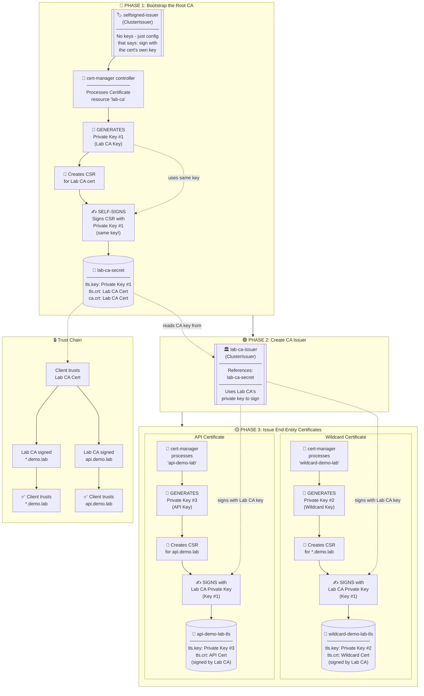
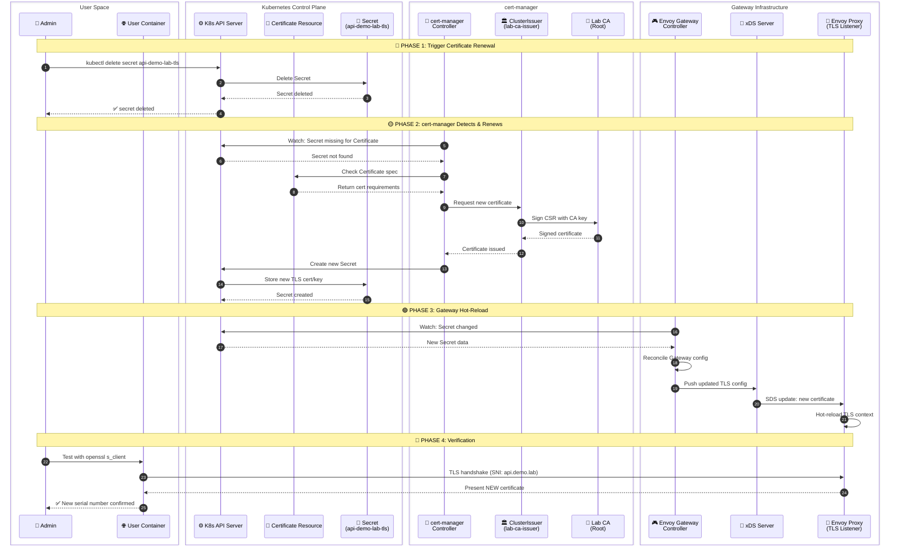

## Transport Layer Security (TLS) with Calico Ingress
该实验展示了如何利用 cert-manager 以及本地的证书颁发机构来实现 TLS 证书的自动化管理。您将学习如何安装 cert-manager，如何将本地证书颁发机构配置到 ClusterIssuers 中，以及如何为不同的服务配置通配符证书和专用证书。

## 概述
### 什么是 `cert-manager` ?
`cert-manager` 是一款功能强大的kubernetes插件，能够自动处理TLS证书管理和颁发工作。它支持多种证书颁发机构，包括内部证书颁发机构、HashiCorp Value PKI、自签名证书，以及 Let's Encrypt等公共证书颁发机构。

|Feature|Description|
|---|---|
|**Gateway API Support**|Uses standard Kubernetes Gateway API resources|
|**Envoy-based**|Leverages Envoy proxy for high-performance traffic management|
|**Traffic Splitting**|Route traffic to multiple backends with weighted distribution|
|**Canary Deployments**|Gradually roll out new versions with controlled traffic percentages|
|**BGP Integration**|Advertise gateway IPs via BGP for external accessibility|
### Certificate Strategies 证书策略
该实验展示了两种常见的证书管理策略：
1. 通配符证书(`*.demo.lab`)
	- 使用机构：`store.demo.lab`, `blog.demo.lab`
	- 优点：一个证书即可覆盖多个子域名，管理更加便捷
	- 缺点：如果私钥泄露，其影响范围会更加的广
	- 应用场景：同一域名下的更多应用程序

2. 专用证书(`aip.demo.lab`)
	- 使用该功能的用户：`aip.demo.lab`
	- 优点：更好的隔离性、独立的生命周期；可以单独进行更新或更换，而不会影响其他部分。
	- 缺点：需要管理的证书太多了
	- 应用场景：需要加强安全隔离的关键 API 接口

## 实验配置
![[Pasted image 20261026092259.png]]

## 实验环境
### containerlab topo
```bash
> containerlab inspect -t topology.clab.yaml
09:35:01 INFO Parsing & checking topology file=topology.clab.yaml
╭─────────────────────────┬──────────────────────────┬─────────┬───────────────────────╮
│           Name          │        Kind/Image        │  State  │     IPv4/6 Address    │
├─────────────────────────┼──────────────────────────┼─────────┼───────────────────────┤
│ k01-control-plane       │ ext-container            │ running │ 172.21.0.6            │
│                         │ kindest/node:v1.35.0     │         │ fc00:f853:ccd:e793::6 │
├─────────────────────────┼──────────────────────────┼─────────┼───────────────────────┤
│ k01-worker              │ ext-container            │ running │ 172.21.0.5            │
│                         │ kindest/node:v1.35.0     │         │ fc00:f853:ccd:e793::5 │
├─────────────────────────┼──────────────────────────┼─────────┼───────────────────────┤
│ k01-worker2             │ ext-container            │ running │ 172.21.0.4            │
│                         │ kindest/node:v1.35.0     │         │ fc00:f853:ccd:e793::4 │
├─────────────────────────┼──────────────────────────┼─────────┼───────────────────────┤
│ k01-worker3             │ ext-container            │ running │ 172.21.0.2            │
│                         │ kindest/node:v1.35.0     │         │ fc00:f853:ccd:e793::2 │
├─────────────────────────┼──────────────────────────┼─────────┼───────────────────────┤
│ k01-worker4             │ ext-container            │ running │ 172.21.0.3            │
│                         │ kindest/node:v1.35.0     │         │ fc00:f853:ccd:e793::3 │
├─────────────────────────┼──────────────────────────┼─────────┼───────────────────────┤
│ clab-ingress-tls-ceos01 │ arista_ceos              │ running │ 172.20.20.3           │
│                         │ ceos:4.34.0F             │         │ 3fff:172:20:20::3     │
├─────────────────────────┼──────────────────────────┼─────────┼───────────────────────┤
│ clab-ingress-tls-user   │ linux                    │ running │ 172.20.20.2           │
│                         │ nicolaka/netshoot:latest │         │ 3fff:172:20:20::2     │
├─────────────────────────┼──────────────────────────┼─────────┼───────────────────────┤
│ k01-control-plane       │ k8s-kind                 │ running │ 172.21.0.6            │
│                         │ kindest/node:v1.35.0     │         │ fc00:f853:ccd:e793::6 │
├─────────────────────────┼──────────────────────────┼─────────┼───────────────────────┤
│ k01-worker              │ k8s-kind                 │ running │ 172.21.0.5            │
│                         │ kindest/node:v1.35.0     │         │ fc00:f853:ccd:e793::5 │
├─────────────────────────┼──────────────────────────┼─────────┼───────────────────────┤
│ k01-worker2             │ k8s-kind                 │ running │ 172.21.0.4            │
│                         │ kindest/node:v1.35.0     │         │ fc00:f853:ccd:e793::4 │
├─────────────────────────┼──────────────────────────┼─────────┼───────────────────────┤
│ k01-worker3             │ k8s-kind                 │ running │ 172.21.0.2            │
│                         │ kindest/node:v1.35.0     │         │ fc00:f853:ccd:e793::2 │
├─────────────────────────┼──────────────────────────┼─────────┼───────────────────────┤
│ k01-worker4             │ k8s-kind                 │ running │ 172.21.0.3            │
│                         │ kindest/node:v1.35.0     │         │ fc00:f853:ccd:e793::3 │
╰─────────────────────────┴──────────────────────────┴─────────┴───────────────────────╯
```

### k8s 状态
查看节点运行状态
```bash
> kubectl get nodes -o wide
NAME                STATUS   ROLES           AGE   VERSION   INTERNAL-IP   EXTERNAL-IP   OS-IMAGE                         KERNEL-VERSION     CONTAINER-RUNTIME
k01-control-plane   Ready    control-plane   32m   v1.35.0   10.10.10.10   <none>        Debian GNU/Linux 12 (bookworm)   7.0.0-34-generic   containerd://2.2.0
k01-worker          Ready    <none>          31m   v1.35.0   10.10.10.11   <none>        Debian GNU/Linux 12 (bookworm)   7.0.0-34-generic   containerd://2.2.0
k01-worker2         Ready    <none>          31m   v1.35.0   10.10.10.12   <none>        Debian GNU/Linux 12 (bookworm)   7.0.0-34-generic   containerd://2.2.0
k01-worker3         Ready    <none>          31m   v1.35.0   10.10.10.13   <none>        Debian GNU/Linux 12 (bookworm)   7.0.0-34-generic   containerd://2.2.0
k01-worker4         Ready    <none>          31m   v1.35.0   10.10.10.14   <none>        Debian GNU/Linux 12 (bookworm)   7.0.0-34-generic   containerd://2.2.0
```

查看gatewayClass 是否正确
```bash
> kubectl get gatewayclasses
NAME                   CONTROLLER                                      ACCEPTED   AGE
tigera-gateway-class   gateway.envoyproxy.io/gatewayclass-controller   True       2m26s
```

## 安装cert-manager
在集群中安装cert-manager，以便在集群中管理TLS证书。

### 了解cert-manager的各个组成部分

| Component       | Description                                           |
| --------------- | ----------------------------------------------------- |
| **Controller**  | Watches Certificate resources and issues certificates |
| **Webhook**     | Validates and mutates cert-manager resources          |
| **CA Injector** | Injects CA bundles into webhooks and API services     |
### 安装cert-manager
使用官方清单安装 `cert-manager`
```bash
kubectl apply -f https://github.com/cert-manager/cert-manager/releases/download/v1.16.2/cert-manager.yaml
```

```bash
namespace/cert-manager created customresourcedefinition.apiextensions.k8s.io/certificaterequests.cert-manager.io created customresourcedefinition.apiextensions.k8s.io/certificates.cert-manager.io created customresourcedefinition.apiextensions.k8s.io/challenges.acme.cert-manager.io created customresourcedefinition.apiextensions.k8s.io/clusterissuers.cert-manager.io created customresourcedefinition.apiextensions.k8s.io/issuers.cert-manager.io created customresourcedefinition.apiextensions.k8s.io/orders.acme.cert-manager.io created 
...
deployment.apps/cert-manager created 
deployment.apps/cert-manager-cainjector  created 
deployment.apps/cert-manager-webhook created
```

### 等待 cert-manager 准备好
```bash
kubectl wait --for=condition=available --timeout=300s deployment/cert-manager -n cert-manager 
kubectl wait --for=condition=available --timeout=300s deployment/cert-manager-webhook -n cert-manager 
kubectl wait --for=condition=available --timeout=300s deployment/cert-manager-cainjector -n cert-manager
```

### 验证cert-manager的安装情况
```bash
> kubectl get pods -n cert-manager
NAME                                      READY   STATUS    RESTARTS   AGE
cert-manager-776b4896c8-wqf84             1/1     Running   0          36m
cert-manager-cainjector-7f69cbff6-kdcxz   1/1     Running   0          36m
cert-manager-webhook-68fb4b9bcc-4ldsq     1/1     Running   0          36m
```

这些Pod主要实现了哪些功能？

|Pod|Description|
|---|---|
|**cert-manager**|The main controller that watches for Certificate, CertificateRequest, and Issuer resources. It processes certificate requests, communicates with CAs, and stores issued certificates as Kubernetes Secrets.|
|**cert-manager-cainjector**|Injects CA certificates into webhook configurations, API services, and Custom Resource Definitions. This ensures that components trusting cert-manager-issued certificates have the correct CA bundle.|
|**cert-manager-webhook**|A validating and mutating admission webhook that validates cert-manager resources before they're persisted. It ensures Certificate and Issuer configurations are correct and converts between API versions.|
请确认cert-manager的CRDs已经安装
```bash
> kubectl get crds | grep cert-manager
certificaterequests.cert-manager.io                     2026-10-26T02:08:19Z
certificates.cert-manager.io                            2026-10-26T02:08:19Z
challenges.acme.cert-manager.io                         2026-10-26T02:08:19Z
clusterissuers.cert-manager.io                          2026-10-26T02:08:19Z
issuers.cert-manager.io                                 2026-10-26T02:08:19Z
orders.acme.cert-manager.io                             2026-10-26T02:08:20Z
```

### 使用自签名证书测试 cert-manager
在继续之前，让我们通过创建一个测试证书来验证 cert-manager 是否正常运行。这项测试可以确保：
- Cert-manager 控制器能够处理证书相关的资源。
- Cert-manager的Webhook功能可以用来验证和接受各种资源
- Cert-manager能够生成真实的X.509 证书，并将其作为Kubernetes中的Secrets进行存储

> 该测试使用了自签名证书颁发机构，因为它不需要任何外部依赖，能够即时生成证书。所生成的证书是符合标准的、具有加密效力的 X.509 证书——只不过由于是自签名证书，因此浏览器不会信任它。我们稍后创建的实验室证书颁发机构也遵循同样的原理。

创建测试资源

```bash
> cat <<EOF | kubectl apply -f -
apiVersion: v1
kind: Namespace
metadata:
  name: cert-manager-test
---
apiVersion: cert-manager.io/v1
kind: Issuer
metadata:
  name: test-selfsigned
  namespace: cert-manager-test
spec:
  selfSigned: {}
---
apiVersion: cert-manager.io/v1
kind: Certificate
metadata:
  name: selfsigned-cert
  namespace: cert-manager-test
spec:
  dnsNames:
    - example.com
  secretName: selfsigned-cert-tls
  issuerRef:
    name: test-selfsigned
EOF
namespace/cert-manager-test created
issuer.cert-manager.io/test-selfsigned created
certificate.cert-manager.io/selfsigned-cert created
```


请确认测试证书已经颁发：
```bash
> kubectl get certificate -n cert-manager-test
NAME              READY   SECRET                AGE
selfsigned-cert   True    selfsigned-cert-tls   46s
```

当证书被创建时：
1. Cert-manager 生成了私钥
2. 已创建证书签名请求（CSR）
3. 使用自签名证书签署该证书
4. 将证书存储在kubernetes的Secret中

你可以使用以下命令来查看证书的实际内容
```bash
> kubectl get secret selfsigned-cert-tls -n cert-manager-test -o jsonpath='{.data.tls\.crt}' | base64 -d | openssl x509 -text -noout | head -15
Certificate:
    Data:
        Version: 3 (0x2)
        Serial Number:
            d2:bd:8b:9d:e9:74:31:93:00:c1:3a:c5:3a:e7:9f:4a
        Signature Algorithm: sha256WithRSAEncryption
        Issuer: 
        Validity
            Not Before: Oct 26 02:49:53 2026 GMT
            Not After : Jan 24 02:49:53 2027 GMT
        Subject: 
        Subject Public Key Info:
            Public Key Algorithm: rsaEncryption
                Public-Key: (2048 bit)
                Modulus:
~ >  
```

## 部署演示应用
我们部署三个演示应用程序，这些应用程序将通过TLS网管访问服务
### 创建演示命名空间
```bash
kubectl create namespace cert-manager-demo
```

### 检查Store应用
```bash
cat k8s-manifests/app-store.yaml
```

- 创建爱你一个deployment应用：使用Nginx提供自定义的HTML页面托管服务
- 在80端口上创建一个ClusterIP服务
- 使用 `cert-manager-demo` 命名空间
- Pods在非BGP工作节点上运行(work3, work4)

### 部署应用
```bash
kubectl apply -f k8s-manifests/app-store.yaml
```

### 部署api应用程序

```bash
kubectl apply -f k8s-manifests/app-api.yaml
```

### 验证应用程序部署情况

请检查所有容器是否都在正常运行：
```bash
> kubectl get pods -n cert-manager-demo -o wide
NAME                     READY   STATUS    RESTARTS   AGE   IP                NODE          NOMINATED NODE   READINESS GATES
api-8449cdf5ff-b2wz9     1/1     Running   0          33m   192.168.209.69    k01-worker3   <none>           <none>
api-8449cdf5ff-wrtk9     1/1     Running   0          33m   192.168.136.197   k01-worker4   <none>           <none>
blog-689f77967f-j5ff4    1/1     Running   0          33m   192.168.209.70    k01-worker3   <none>           <none>
blog-689f77967f-pg9p4    1/1     Running   0          33m   192.168.136.198   k01-worker4   <none>           <none>
store-747f75c684-d5cth   1/1     Running   0          33m   192.168.136.199   k01-worker4   <none>           <none>
store-747f75c684-kz2r7   1/1     Running   0          33m   192.168.209.71    k01-worker3   <none>           <none>
```

确认各项服务运行正常
```bash
> kubectl get svc -n cert-manager-demo
NAME    TYPE        CLUSTER-IP     EXTERNAL-IP   PORT(S)   AGE
api     ClusterIP   10.96.62.32    <none>        80/TCP    34m
blog    ClusterIP   10.96.34.183   <none>        80/TCP    34m
store   ClusterIP   10.96.36.24    <none>        80/TCP    33m
```

## 创建证书颁发机构
在这个阶段，你需要创建用于定义证书获取方式的 ClusterIssuers。由于这只是一个实验环境，因此我们使用本地的证书颁发机构，而不是像 Let’s Encrypt 这样的公共证书颁发机构。

![[Pasted image 20261026110801.png]]

### 理解 ClusterIssuers 机制

cluster-issuers.yaml▸ 文件中包含了实验室所需的两个发行者相关信息：

| Issuer              | Purpose                                                  |
| ------------------- | -------------------------------------------------------- |
| `selfsigned-issuer` | Bootstrapping - creates the root CA certificate          |
| `lab-ca-issuer`     | **Primary issuer** - signs certificates using the Lab CA |
**Self-Signed Issuer (for bootstrapping):**

```yaml
apiVersion: cert-manager.io/v1
kind: ClusterIssuer
metadata:
  name: selfsigned-issuer
spec:
  selfSigned: {}
```

**Lab CA Issuer (primary):**

```yaml
apiVersion: cert-manager.io/v1
kind: ClusterIssuer
metadata:
  name: lab-ca-issuer
spec:
  ca:
    secretName: lab-ca-secret
```

> [!Note]
> **Why use a local CA instead of self-signed certificates?**
> - Self-signed certs are signed by their own key (no trust chain)
> - CA-signed certs have a proper chain: `Root CA → Leaf Certificate`
> - You can trust the CA once and all issued certs are trusted
> - This mirrors how enterprise PKI and public CAs work

### 创建 ClusterIssuers
```bash
kubectl apply -f tls-config/cluster-issuers.yaml
```

### Verify ClusterIssuers

```bash
> kubectl get clusterissuers -o wide
NAME                READY   STATUS                AGE
lab-ca-issuer       True    Signing CA verified   64m
selfsigned-issuer   True                          54m
```

## Issue Certificates  颁发证书

现在，您将创建用于向我们的实验室证书颁发机构请求证书的证书资源。
![[Pasted image 20261026111345.png]]


### 了解证书相关资源

```bash
cat tls-config/certificates.yaml
```
certificates.yaml 文件按照特定的顺序定义了三份证书：

The [certificates.yaml](tls-config/certificates.yaml) file defines three certificates in a specific order:

**1. Lab CA Certificate** (creates the root CA - must be created first):

```yaml
apiVersion: cert-manager.io/v1
kind: Certificate
metadata:
  name: lab-ca
  namespace: cert-manager
spec:
  isCA: true                        # This is a CA certificate
  secretName: lab-ca-secret         # Where the CA cert/key is stored
  commonName: "Demo Lab Certificate Authority"
  duration: 87600h                  # 10 years validity
  issuerRef:
    name: selfsigned-issuer         # Self-sign the root CA
    kind: ClusterIssuer
```

**2. Wildcard Certificate** (for store.demo.lab and blog.demo.lab):

```yaml
apiVersion: cert-manager.io/v1
kind: Certificate
metadata:
  name: wildcard-demo-lab
  namespace: cert-manager-demo
spec:
  secretName: wildcard-demo-lab-tls
  commonName: "*.demo.lab"
  dnsNames:
    - "*.demo.lab"                  # Covers all subdomains
    - "demo.lab"                    # Also cover apex domain
  issuerRef:
    name: lab-ca-issuer             # Signed by our Lab CA
    kind: ClusterIssuer
```

**3. Dedicated Certificate** (for api.demo.lab only):

```yaml
apiVersion: cert-manager.io/v1
kind: Certificate
metadata:
  name: api-demo-lab
  namespace: cert-manager-demo
spec:
  secretName: api-demo-lab-tls
  commonName: "api.demo.lab"
  dnsNames:
    - "api.demo.lab"                # Only valid for this domain
  issuerRef:
    name: lab-ca-issuer             # Signed by our Lab CA
    kind: ClusterIssuer
```

> [!Note]
> **Certificate chain:** The Lab CA is self-signed, but the wildcard and API certificates are signed by the Lab CA. This creates a proper trust chain just like in production PKI environments.

**证书链与密钥生成流程图：**





**Key Points:**

| Step | What Happens | Private Key | Who Signs |
|------|--------------|-------------|-----------|
| **1** | Lab CA Certificate created | cert-manager generates **Key #1** | Self-signed (Key #1 signs its own cert) |
| **2** | lab-ca-issuer configured | No new key - references lab-ca-secret | N/A - just config |
| **3** | Wildcard cert created | cert-manager generates **Key #2** | Lab CA (using Key #1) |
| **4** | API cert created | cert-manager generates **Key #3** | Lab CA (using Key #1) |

> [!IMPORTANT]
> **Self-signing explained:** When `selfsigned-issuer` processes a certificate, cert-manager generates a new private key, creates a CSR, then signs that CSR with the **same private key** it just generated. The certificate literally signs itself - that's why it's called "self-signed." This is only used for root CAs.


![[Pasted image 20261026111651.png]]


#### 5.2 Create the Certificates

```bash
kubectl apply -f tls-config/certificates.yaml
```

```
certificate.cert-manager.io/lab-ca created
certificate.cert-manager.io/wildcard-demo-lab created
certificate.cert-manager.io/api-demo-lab created
```

#### 5.3 Watch Certificate Issuance

Watch cert-manager issue the certificates:

```bash
kubectl get certificates -A -w
```

```
NAMESPACE           NAME                READY   SECRET                   AGE
cert-manager        lab-ca              False   lab-ca-secret            0s
cert-manager-demo   wildcard-demo-lab   False   wildcard-demo-lab-tls    0s
cert-manager-demo   api-demo-lab        False   api-demo-lab-tls         0s
cert-manager        lab-ca              True    lab-ca-secret            2s
cert-manager-demo   wildcard-demo-lab   True    wildcard-demo-lab-tls    3s
cert-manager-demo   api-demo-lab        True    api-demo-lab-tls         3s
```

Press `Ctrl+C` to exit the watch.

#### 5.4 Verify All Certificates Are Ready

```bash
kubectl get certificates -A
```

```
NAMESPACE           NAME                READY   SECRET                   AGE
cert-manager        lab-ca              True    lab-ca-secret            1m
cert-manager-demo   wildcard-demo-lab   True    wildcard-demo-lab-tls    1m
cert-manager-demo   api-demo-lab        True    api-demo-lab-tls         1m
```

#### 5.5 Verify ClusterIssuers Again

Now check the lab-ca-issuer:

```bash
kubectl get clusterissuers lab-ca-issuer
```

```
NAME            READY   STATUS                  AGE
lab-ca-issuer   True    Signing CA verified     2m
```

The issuer is now ready because the Lab CA certificate has been created.

#### 5.6 Examine Certificate Details

View the wildcard certificate details:

```bash
kubectl describe certificate wildcard-demo-lab -n cert-manager-demo
```

```yaml
Name:         wildcard-demo-lab
Namespace:    cert-manager-demo
...
Spec:
  Common Name:  *.demo.lab
  Dns Names:
    *.demo.lab
    demo.lab
  Duration:     2160h0m0s
  Issuer Ref:
    Group:      cert-manager.io
    Kind:       ClusterIssuer
    Name:       lab-ca-issuer
  Private Key:
    Algorithm:  ECDSA
    Size:       256
  Renew Before:  720h0m0s
  Secret Name:   wildcard-demo-lab-tls
Status:
  Conditions:
    Type:    Ready
    Status:  True
    Reason:  Ready
    Message: Certificate is up to date and has not expired
  Not After:               2024-04-15T12:00:00Z
  Not Before:              2024-01-15T12:00:00Z
  Renewal Time:            2024-03-16T12:00:00Z
```

#### 5.7 Verify TLS Secrets

Check that the TLS secrets have been created:

```bash
kubectl get secrets -n cert-manager-demo | grep tls
```

```
NAME                    TYPE                DATA   AGE
wildcard-demo-lab-tls   kubernetes.io/tls   3      2m
api-demo-lab-tls        kubernetes.io/tls   3      2m
```

Examine the wildcard certificate:

```bash
kubectl get secret wildcard-demo-lab-tls -n cert-manager-demo -o jsonpath='{.data.tls\.crt}' | base64 -d | openssl x509 -text -noout | head -20
```

```
Certificate:
    Data:
        Version: 3 (0x2)
        Serial Number: ...
        Signature Algorithm: ecdsa-with-SHA256
        Issuer: O = Demo Lab, CN = Demo Lab Certificate Authority
        Validity
            Not Before: Jan 15 12:00:00 2024 GMT
            Not After : Apr 15 12:00:00 2024 GMT
        Subject: O = Demo Lab, CN = *.demo.lab
        Subject Public Key Info:
            Public Key Algorithm: id-ecPublicKey
                Public-Key: (256 bit)
```

> [!Note]
> Notice the **Issuer** field shows "Demo Lab Certificate Authority" - this proves the certificate was signed by our Lab CA, not self-signed.

### 6. Configure TLS Gateway and Routes

In this final configuration phase, you'll create the Gateway with TLS listeners and HTTPRoutes for each application.

#### 6.1 Understand the TLS Gateway

Examine the [Gateway manifest](k8s-manifests/gateway.yaml):

```bash
cat k8s-manifests/gateway.yaml
```

```yaml
apiVersion: gateway.networking.k8s.io/v1
kind: Gateway
metadata:
  name: tls-gateway
  namespace: default
spec:
  gatewayClassName: tigera-gateway-class
  listeners:
    # HTTP listener for HTTP to HTTPS redirects
    - name: http
      protocol: HTTP
      port: 80
      allowedRoutes:
        namespaces:
          from: All
    
    # HTTPS listener for store.demo.lab (wildcard cert)
    - name: https-store
      protocol: HTTPS
      port: 443
      hostname: "store.demo.lab"
      tls:
        mode: Terminate
        certificateRefs:
          - name: wildcard-demo-lab-tls
            namespace: cert-manager-demo
            kind: Secret
      allowedRoutes:
        namespaces:
          from: All
    
    # HTTPS listener for blog.demo.lab (same wildcard cert)
    - name: https-blog
      ...
    
    # HTTPS listener for api.demo.lab (dedicated cert)
    - name: https-api
      ...
```

**Key points:**
- Four listeners: HTTP (port 80) + three HTTPS (port 443)
- Each HTTPS listener has a specific hostname
- `tls.certificateRefs` points to the certificate secrets
- Store and Blog share the wildcard certificate
- API has its own dedicated certificate

#### 6.2 Create the TLS Gateway

```bash
kubectl apply -f k8s-manifests/gateway.yaml
```

```
gateway.gateway.networking.k8s.io/tls-gateway created
```

#### 6.3 Verify Gateway Status

Check that the Gateway is programmed:

```bash
kubectl get gateway tls-gateway
```

```
NAME          CLASS                  ADDRESS        PROGRAMMED   AGE
tls-gateway   tigera-gateway-class   10.100.1.100   True         30s
```

Note the external IP address - you'll use this to access the services.

#### 6.4 Check Gateway Details

View detailed Gateway status:

```bash
kubectl describe gateway tls-gateway | grep secret
```

Look for the listener statuses - all should show `Attached: True` and `ResolvedRefs: True`.

#### 6.5 Create the ReferenceGrant

The Gateway needs permission to reference secrets in the `cert-manager-demo` namespace. Examine and create the [ReferenceGrant](k8s-manifests/reference-grant.yaml):

```bash
cat k8s-manifests/reference-grant.yaml
```

```bash
kubectl apply -f k8s-manifests/reference-grant.yaml
```

```
referencegrant.gateway.networking.k8s.io/allow-gateway-secrets created
```

#### 6.6 Understand HTTPRoutes

Examine the [HTTPRoutes manifest](k8s-manifests/httproutes.yaml):

```bash
cat k8s-manifests/httproutes.yaml
```

Each HTTPRoute:
- Attaches to the TLS Gateway
- Specifies a hostname
- Routes traffic to the appropriate backend service
- Includes HTTP to HTTPS redirect rules

#### 6.7 Create the HTTPRoutes

```bash
kubectl apply -f k8s-manifests/httproutes.yaml
```

```
httproute.gateway.networking.k8s.io/store-route created
httproute.gateway.networking.k8s.io/blog-route created
httproute.gateway.networking.k8s.io/api-route created
httproute.gateway.networking.k8s.io/http-redirect created
```

#### 6.8 Verify HTTPRoutes

Check the HTTPRoutes status:

```bash
kubectl get httproutes -n default
```

```
NAME            HOSTNAMES              AGE
store-route     ["store.demo.lab"]     30s
blog-route      ["blog.demo.lab"]      30s
api-route       ["api.demo.lab"]       30s
http-redirect                          30s
```

### 7. Test the Setup

Now let's test the complete TLS setup from the user container.

#### 7.1 Get the Gateway IP

```bash
GATEWAY_IP=$(kubectl get gateway tls-gateway -o jsonpath='{.status.addresses[0].value}')
echo "Gateway IP: $GATEWAY_IP"
```

#### 7.2 Add DNS Entries to User Container

Add the hostnames to the user container's /etc/hosts:

```bash
sudo docker exec clab-ingress-tls-user sh -c "echo '$GATEWAY_IP store.demo.lab blog.demo.lab api.demo.lab' >> /etc/hosts"
```

Verify the entries were added:

```bash
sudo docker exec clab-ingress-tls-user cat /etc/hosts
```

#### 7.3 Add Lab CA as Trusted Certificate

Extract the Lab CA certificate and copy it to the user container:

```bash
# Extract the Lab CA certificate from Kubernetes
kubectl get secret lab-ca-secret -n cert-manager -o jsonpath='{.data.tls\.crt}' | base64 -d > /tmp/lab-ca.crt

# Copy the CA certificate to the user container
sudo docker cp /tmp/lab-ca.crt clab-ingress-tls-user:/tmp/lab-ca.crt
```

Verify the CA certificate was copied:

```bash
sudo docker exec clab-ingress-tls-user cat /tmp/lab-ca.crt
```

```
-----BEGIN CERTIFICATE-----
MIIBqDCCAU... (Lab CA certificate content)
-----END CERTIFICATE-----
```

#### 7.4 Test HTTPS Access with Certificate Verification

Now test HTTPS access using the `--cacert` flag to verify the certificate against our Lab CA.

Test the Store application from the user container:

```bash
sudo docker exec clab-ingress-tls-user curl -v --cacert /tmp/lab-ca.crt https://store.demo.lab/ 2>&1 | grep -E "(subject|issuer|SSL|verify)"
```

```
* SSL connection using TLSv1.3 / TLS_AES_256_GCM_SHA384
*  SSL certificate verify ok.
*   subject: O=Demo Lab; CN=*.demo.lab
*   issuer: O=Demo Lab; OU=Infrastructure; CN=Demo Lab Certificate Authority
```

Test the Blog application:

```bash
sudo docker exec clab-ingress-tls-user curl -v --cacert /tmp/lab-ca.crt https://blog.demo.lab/ 2>&1 | grep -E "(subject|issuer|SSL|verify)"
```

```
* SSL connection using TLSv1.3 / TLS_AES_256_GCM_SHA384
*  SSL certificate verify ok.
*   subject: O=Demo Lab; CN=*.demo.lab
*   issuer: O=Demo Lab; OU=Infrastructure; CN=Demo Lab Certificate Authority
```

Test the API application (dedicated certificate):

```bash
sudo docker exec clab-ingress-tls-user curl -v --cacert /tmp/lab-ca.crt https://api.demo.lab/ 2>&1 | grep -E "(subject|issuer|SSL|verify)"
```

```
* SSL connection using TLSv1.3 / TLS_AES_256_GCM_SHA384
*  SSL certificate verify ok.
*   subject: O=Demo Lab; CN=api.demo.lab
*   issuer: O=Demo Lab; OU=Infrastructure; CN=Demo Lab Certificate Authority
```

> [!Note]
> Notice the `SSL certificate verify ok` message - this confirms the Lab CA is properly trusted and the certificate chain is valid. The `--cacert` flag tells curl to use our Lab CA certificate for verification.

#### 7.5 Test HTTP to HTTPS Redirect

Test that HTTP requests are redirected to HTTPS:

```bash
sudo docker exec clab-ingress-tls-user curl -v http://store.demo.lab/ 2>&1 | grep -E "(Location|HTTP)"
```

```
< HTTP/1.1 301 Moved Permanently
< Location: https://store.demo.lab/
```

#### 7.6 Verify Certificate Chain

Examine the full certificate chain for the wildcard cert:

```bash
sudo docker exec clab-ingress-tls-user sh -c "echo | openssl s_client -connect store.demo.lab:443 -servername store.demo.lab 2>/dev/null | openssl x509 -text -noout | grep -A2 'Subject:'"
```

#### 7.7 Test Certificate Renewal Simulation



**Component Interactions Explained:**

| Component | Role | Interaction |
|-----------|------|-------------|
| **cert-manager Controller** | Certificate lifecycle manager | Watches Certificate resources and their secrets, triggers renewal when needed |
| **Certificate Resource** | Desired state definition | Defines cert specs (duration, domains, issuer) |
| **ClusterIssuer** | CA configuration | References the Lab CA for signing certificates |
| **Lab CA** | Root Certificate Authority | Signs new certificates with its private key |
| **Secret** | Certificate storage | Stores `tls.crt` and `tls.key` for gateway consumption |
| **Envoy Gateway Controller** | Gateway reconciler | Watches secrets, updates xDS configuration |
| **xDS Server** | Config distribution | Pushes updated certificates to Envoy via SDS (Secret Discovery Service) |
| **Envoy Proxy** | TLS termination | Hot-reloads certificates without connection drops |

> [!TIP]
> The entire renewal process happens automatically and without downtime. The Envoy proxy performs a hot-reload of the TLS context, meaning existing connections continue uninterrupted while new connections receive the updated certificate.

cert-manager automatically renews certificates before expiry. Let's simulate a renewal and verify the new certificate is loaded by the Envoy gateway.

**Step 1: Note the current certificate serial number**

```bash
# Get the current certificate serial number from the gateway
sudo docker exec clab-ingress-tls-user sh -c "echo | openssl s_client -connect api.demo.lab:443 -servername api.demo.lab 2>/dev/null | openssl x509 -noout -serial"
```

```
serial=1A2B3C4D5E6F...
```

Save this serial number for comparison later.

**Step 2: Delete the certificate secret to trigger renewal**

```bash
kubectl delete secret api-demo-lab-tls -n cert-manager-demo
```

**Step 3: Watch cert-manager recreate the certificate**

```bash
kubectl get certificate api-demo-lab -n cert-manager-demo -w
```

```
NAME           READY   SECRET             AGE
api-demo-lab   False   api-demo-lab-tls   5m
api-demo-lab   True    api-demo-lab-tls   5m
```

Press `Ctrl+C` to exit the watch once it shows `READY=True`.

**Step 4: Verify the new certificate has a different serial number**

```bash
# Get the new certificate serial number from Kubernetes
kubectl get secret api-demo-lab-tls -n cert-manager-demo -o jsonpath='{.data.tls\.crt}' | base64 -d | openssl x509 -noout -serial
```

```
serial=7F8E9D0C1B2A...   # Different from the original!
```

**Step 5: Verify the gateway is serving the new certificate**

The Envoy gateway automatically picks up the new certificate from the Secret. Test it:

```bash
# Get the serial number being served by the gateway
sudo docker exec clab-ingress-tls-user sh -c "echo | openssl s_client -connect api.demo.lab:443 -servername api.demo.lab 2>/dev/null | openssl x509 -noout -serial"
```

```
serial=7F8E9D0C1B2A...   # Matches the new certificate!
```

**Step 6: Verify full connectivity with the new certificate**

```bash
sudo docker exec clab-ingress-tls-user curl -v --cacert /tmp/lab-ca.crt https://api.demo.lab/ 2>&1 | grep -E "(SSL|verify|subject)"
```

```
* SSL connection using TLSv1.3 / TLS_AES_256_GCM_SHA384
*  SSL certificate verify ok.
*   subject: O=Demo Lab; CN=api.demo.lab
```

> [!Note]
> The Envoy gateway watches for Secret changes and automatically reloads certificates without requiring a restart. This is a key feature for zero-downtime certificate rotation.

**Optional: Monitor Envoy Gateway Logs During Rotation**

You can watch the Envoy gateway logs to see certificate reload events in real-time:

```bash
# In a separate terminal, start watching the Envoy gateway logs
kubectl logs -n tigera-gateway -l gateway.envoyproxy.io/owning-gateway-name=tls-gateway -f
```

When you delete and recreate a certificate secret, you'll see log entries like:

```
[info] xDS: received config update for sds_cluster - version: xxx
[info] Secret resources updated: api-demo-lab-tls
[info] sds: updating secret for listener.443.api.demo.lab
```

You can also check the Envoy Gateway controller logs for Secret watch events:

```bash
# Watch the Envoy Gateway controller logs
kubectl logs -n envoy-gateway-system -l control-plane=envoy-gateway -f
```

Look for entries related to Secret reconciliation:

```
"msg":"reconciled Secret","namespace":"cert-manager-demo","name":"api-demo-lab-tls"
"msg":"updating xDS snapshot","gateway":"default/tls-gateway"
```

## Summary

This lab demonstrated automated TLS certificate management with cert-manager:

| Phase | What You Learned |
|-------|------------------|
| **Phase 1** | Install cert-manager and verify its components |
| **Phase 2** | Deploy demo applications that need TLS |
| **Phase 3** | Create ClusterIssuers for different CAs |
| **Phase 4** | Issue wildcard and dedicated certificates |
| **Phase 5** | Configure TLS Gateway with certificate references |
| **Phase 6** | Test and verify HTTPS connectivity |

**Certificate Strategy Summary:**

| App | Hostname | Certificate | Type |
|-----|----------|-------------|------|
| Store | store.demo.lab | *.demo.lab | Wildcard (shared) |
| Blog | blog.demo.lab | *.demo.lab | Wildcard (shared) |
| API | api.demo.lab | api.demo.lab | Dedicated |

**Key Takeaways:**

1. **cert-manager** automates the entire certificate lifecycle - issuance, renewal, and rotation
2. **ClusterIssuers** provide cluster-wide certificate authority configuration
3. **Local CAs** demonstrate the same concepts as production PKI without external dependencies
4. **Wildcard certificates** reduce management overhead for multiple subdomains
5. **Dedicated certificates** provide better security isolation for critical services
6. **Gateway API** provides native TLS termination with certificate references

## Troubleshooting

### cert-manager Not Installing

If cert-manager fails to install:

```bash
# Check if CRDs are installed
kubectl get crds | grep cert-manager

# Check cert-manager namespace
kubectl get pods -n cert-manager

# Check cert-manager logs
kubectl logs -n cert-manager -l app=cert-manager
```

### Certificate Not Ready

If a certificate is not becoming ready:

```bash
# Check certificate status
kubectl describe certificate <name> -n <namespace>

# Check certificate request
kubectl get certificaterequest -n <namespace>

# Check cert-manager logs
kubectl logs -n cert-manager -l app=cert-manager -f
```

### CA Issuer Shows "Secret Not Found"

If `lab-ca-issuer` shows an error about missing secret:

```bash
# Check if the Lab CA certificate was created
kubectl get certificate lab-ca -n cert-manager

# Verify the secret exists
kubectl get secret lab-ca-secret -n cert-manager

# If missing, re-apply the certificates
kubectl apply -f tls-config/certificates.yaml
```

### Gateway TLS Not Working

If TLS termination is not working:

```bash
# Check if secrets exist
kubectl get secrets -n cert-manager-demo | grep tls

# Check Gateway status
kubectl describe gateway tls-gateway

# Check Envoy proxy logs
kubectl logs -n tigera-gateway -l gateway.envoyproxy.io/owning-gateway-name=tls-gateway
```

## Additional Notes

### Switching Between Issuers

You can change a certificate's issuer without recreating it:

1. Update the certificate to use a different issuer:

```bash
# Example: Switch from lab-ca-issuer to selfsigned-issuer
kubectl patch certificate api-demo-lab -n cert-manager-demo --type='json' -p='[
  {"op": "replace", "path": "/spec/issuerRef/name", "value": "selfsigned-issuer"}
]'
```

2. Delete the existing secret to trigger re-issuance:

```bash
kubectl delete secret api-demo-lab-tls -n cert-manager-demo
```

3. Watch the certificate be re-issued:

```bash
kubectl get certificate api-demo-lab -n cert-manager-demo -w
```

### Certificate Rotation Best Practices

| Setting | Recommended Value | Reason |
|---------|-------------------|--------|
| Duration | 90 days | Industry standard, balances security & ops |
| Renew Before | 30 days | Allows time to fix issues |
| Private Key Algorithm | ECDSA P-256 | Modern, efficient, strong security |
| Key Rotation | Enabled | Fresh key on each renewal |

### cert-manager Architecture

```
┌─────────────────────────────────────────────────────────────────────────┐
│                        CERT-MANAGER ARCHITECTURE                        │
├─────────────────────────────────────────────────────────────────────────┤
│                                                                         │
│  ┌──────────────────┐    ┌──────────────────┐    ┌──────────────────┐   │
│  │   Controller     │    │    CA Injector   │    │     Webhook      │   │
│  │                  │    │                  │    │                  │   │
│  │ • Watches CRs    │    │ • Injects CA     │    │ • Validates CRs  │   │
│  │ • Issues certs   │    │   bundles        │    │ • Mutates CRs    │   │
│  │ • Multiple       │    │ • Updates        │    │ • Converts       │   │
│  │   issuer types   │    │   annotations    │    │   versions       │   │
│  └────────┬─────────┘    └──────────────────┘    └──────────────────┘   │
│           │                                                             │
│           ▼                                                             │
│  ┌─────────────────────────────────────────────────────────────────┐    │
│  │                      Custom Resources                           │    │
│  │  ┌───────────┐  ┌────────────┐  ┌───────────┐  ┌────────────┐   │    │
│  │  │ClusterIss.│  │Certificate │  │CertReq    │  │Order       │   │    │
│  │  └───────────┘  └────────────┘  └───────────┘  └────────────┘   │    │
│  └─────────────────────────────────────────────────────────────────┘    │
│                                                                         │
└─────────────────────────────────────────────────────────────────────────┘
```

### Certificate Issuance Flow

```
1. Certificate CR Created
         │
         ▼
2. cert-manager Controller detects Certificate
         │
         ▼
3. CertificateRequest CR created
         │
         ▼
4. Issuer processes request
         │
         ├── Self-signed: Generates immediately (signs with own key)
         │
         └── CA: Signs with CA private key (used in this lab)
         │
         ▼
5. TLS Secret created with certificate + key
         │
         ▼
6. Gateway picks up secret for TLS termination
         │
         ▼
7. HTTPS endpoint ready
```

> [!Note]
> In production with public CAs like Let's Encrypt, step 4 would include ACME challenges (HTTP-01 or DNS-01) to verify domain ownership. Our local CA skips this since we control both the CA and the domains.


