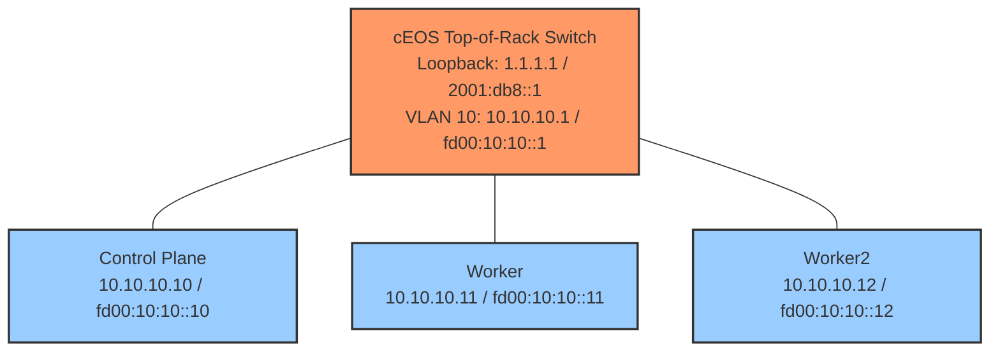

Calico IPv4 and IPv6协议 -- 双栈网络技术，在这种架构下，容器可以通过IPv4和IPv6两种协议进行通信，从而实现访问内部服务以及外部目标。

## 概述
- 如何使用Calico工具配置一个带有双栈架构的kubernetes集群
- Pod如何同时接收IPv4和IPv6地址?
- VXLAN封装如何实现IPv6节点间的通信
- 如何让Pod能够访问外部的IPv4和IPv6地址
- CoreDNS如何为服务提供A(IPv4)和AAAA(IPv6)记录

## 什么是双栈网络
双栈网络意味着网络实体（节点、Pod、服务）同时拥有IPv4和IPv6地址，这使得应用程序能够：
- 使用IPv4协议与传统系统进行通信
- 利用现代基础设施，通过IPv6进行通信
- 逐步从IPv4过渡到IPv6，同时避免破坏兼容性
在这个实验中，这些Pod能够在上游路由器上同时到达IPv4 1.1.1.1 和 IPv6地址 20001:db8::1， 从而实现真正的双栈外部连接功能。


## kind集群中双栈网络配置

### 集群配置
为了在kubernetes中实现双栈网络功能，需要在创建集群时对其进行配置，kind集群配置文件(dual-stack-no-cni.yaml)
```yaml
# Kind cluster configuration for Dual-Stack networking
# Pods and services get both IPv4 and IPv6 addresses

apiVersion: kind.x-k8s.io/v1alpha4
kind: Cluster
name: dual-stack
networking:
  disableDefaultCNI: true
  # Dual-stack pod subnets
  podSubnet: "192.168.0.0/16,fd00:10:244::/48"
  # Dual-stack service subnets  
  serviceSubnet: "10.96.0.0/16,fd00:10:96::/112"
  # enable dual-stack both IPv4 and IPv6
  ipFamily: dual

```

配置字段解析：

| Setting             | Value                             | Description                                          |
| ------------------- | --------------------------------- | ---------------------------------------------------- |
| `disableDefaultCNI` | `true`                            | Disables Kind's default CNI so we can install Calico |
| `podSubnet`         | `192.168.0.0/16,fd00:10:244::/48` | Comma-separated IPv4 and IPv6 CIDRs for pods         |
| `serviceSubnet`     | `10.96.0.0/16,fd00:10:96::/112`   | Comma-separated IPv4 and IPv6 CIDRs for services     |
| `ipFamily`          | `dual`                            | Enables dual-stack mode (both IPv4 and IPv6)         |

### 节点IP配置
每个节点必须配置为向Kubernetes API 公告 Pv4和IPv6地址信息

```yaml
nodes:
  - role: control-plane
    kubeadmConfigPatches:
      - |
        kind: InitConfiguration
        nodeRegistration:
          kubeletExtraArgs:
            node-ip: "10.10.10.10,fd00:10:10::10"

  - role: worker
    kubeadmConfigPatches:
      - |
        kind: JoinConfiguration
        nodeRegistration:
          kubeletExtraArgs:
            node-ip: "10.10.10.11,fd00:10:10::11"

  - role: worker
    kubeadmConfigPatches:
      - |
        kind: JoinConfiguration
        nodeRegistration:
          kubeletExtraArgs:
            node-ip: "10.10.10.12,fd00:10:10::12"
```

`node-ip` 参数是一个以逗号分隔的列表，包含节点的IPv4地址和IPv6地址。这样就能让kubectl同时向API服务注册这两种地址，从而实现以下功能：
- 节点上拥有双栈地址
- 对双栈Pod的正确调度
- 对Service endpoint的正确选择

## 为什么这些设置很重要
1. `ipFamily: dual` —— 如果没有这个设置，Kubernetes 默认是单栈（仅 IPv4）
2. **逗号分隔的子网** —— 顺序很重要：IPv4 在前，IPv6 在后
3. **每个节点上的** **`node-ip`** —— 确保 kubelet 注册两个地址；否则节点可能只通告一种地址族

>**重要提示：** 双栈必须在集群创建时配置。集群创建后，无法将单栈集群转换为双栈。

## Calico IP池配置
在集群创建完成后，会安装双栈IP池的Calico CNI。

```yaml
apiVersion: operator.tigera.io/v1
kind: Installation
metadata:
  name: default
spec:
  calicoNetwork:
    ipPools:
      # IPv4 IP Pool for pods
      - name: default-ipv4-ippool
        blockSize: 26
        cidr: 192.168.0.0/16
        encapsulation: VXLANCrossSubnet
        natOutgoing: Enabled
        nodeSelector: all()

      # IPv6 IP Pool for pods
      - name: default-ipv6-ippool
        blockSize: 122
        cidr: fd00:10:244::/48
        encapsulation: VXLAN
        natOutgoing: Enabled
        nodeSelector: all()

    # Node address auto-detection (uses eth1 addresses)
    nodeAddressAutodetectionV4:
      cidrs:
        - 10.10.10.0/24
    nodeAddressAutodetectionV6:
      cidrs:
        - fd00:10:10::/64
```

|   |   |   |   |
|---|---|---|---|
|**设置（Setting）**|**IPv4 池（IPv4 Pool）**|**IPv6 池（IPv6 Pool）**|**说明（Description）**|
|**CIDR**|`192.168.0.0/16`|`fd00:10:244::/48`|Pod 的地址范围|
|**块大小（Block Size）**|`/26`（64 个 IP）|`/122`（64 个 IP）|每个节点的分配大小|
|**封装（Encapsulation）**|`VXLANCrossSubnet`|`VXLAN`|Pod 流量的隧道封装方式|
|**NAT Outgoing**|已启用|已启用|对外部流量的 SNAT|

## 节点地址检测
Calico需要知道用于VXLAN隧道的节点IP是什么：

|   |   |   |
|---|---|---|
|**设置（Setting）**|**CIDR**|**用途（Purpose）**|
|`nodeAddressAutodetectionV4`|`10.10.10.0/24`|对 IPv4 VXLAN 使用 eth1 上的 IPv4 地址|
|`nodeAddressAutodetectionV6`|`fd00:10:10::/64`|对 IPv6 VXLAN 使用 eth1 上的 IPv6 地址|
这样能确保Calico使用eth1接口(连接到cEOS交换机)，而不是默认的Docker网络接口

## 实验topo结构


- 节点通过eth1以双栈地址(IPv4+IPv6)连接到ToR交换机。
- Pod同时拥有IPv4(`192.168.x.x`)和IPv6( `fd00:10:244: :x` )地址
- 外部连通性：Pod 能够向ToR环回口上的 `1.1.1.1` (IPv4)和 `2001:db8::1` (IPv6) 发送数据包(能ping通)
- 内部连通性：Pod-to-Pod的IPv6通信使用VXLAN封装

```
                    ┌─────────────────────────────────────────────────────┐
                    │              Arista cEOS Switch                     │
                    │                                                     │
                    │  VLAN 10 Interface:                                 │
                    │    IPv4: 10.10.10.1/24                              │
                    │    IPv6: fd00:10:10::1/64                           │
                    │                                                     │
                    │  Loopback0 (External Destination):                  │
                    │    IPv4: 1.1.1.1/32                                 │
                    │    IPv6: 2001:db8::1/128                            │
                    │                                                     │
                    └───────┬─────────────┬─────────────┬─────────────────┘
                            │ eth1        │ eth2        │ eth3
                            │             │             │
        ┌───────────────────┴───┐   ┌─────┴─────┐   ┌───┴───────────────────┐
        │  Control Plane        │   │  Worker   │   │  Worker2              │
        │                       │   │           │   │                       │
        │  eth1:                │   │  eth1:    │   │  eth1:                │
        │  IPv4: 10.10.10.10    │   │  10.10.   │   │  IPv4: 10.10.10.12    │
        │  IPv6: fd00:10:10::10 │   │  10.11    │   │  IPv6: fd00:10:10::12 │
        │                       │   │  fd00:    │   │                       │
        │  Pod CIDR:            │   │  10:10::  │   │  Pod CIDR:            │
        │  192.168.x.0/26 (v4)  │   │  11       │   │  192.168.x.0/26 (v4)  │
        │  fd00:10:244::/122(v6)│   │           │   │  fd00:10:244::/122(v6)│
        └───────────────────────┘   └───────────┘   └───────────────────────┘
```


### 网络配置摘要

| Component            | IPv4 Address   | IPv6 Address      |
| -------------------- | -------------- | ----------------- |
| cEOS VLAN 10         | 10.10.10.1/24  | fd00:10:10::1/64  |
| cEOS Loopback0       | 1.1.1.1/32     | 2001:db8::1/128   |
| Control Plane (eth1) | 10.10.10.10/24 | fd00:10:10::10/64 |
| Worker (eth1)        | 10.10.10.11/24 | fd00:10:10::11/64 |
| Worker2 (eth1)       | 10.10.10.12/24 | fd00:10:10::12/64 |
| Pod Network          | 192.168.0.0/16 | fd00:10:244::/48  |
| Service Network      | 10.96.0.0/16   | fd00:10:96::/112  |

## 资源清单
### conatinerlab 配置
```yaml
# ContainerLab topology for Dual-Stack Lab
# 3-node Kind cluster connected to Arista cEOS switch
# Demonstrates pods reaching external IPv4 and IPv6 destinations

name: dual-stack
topology:
  nodes:
    # Arista cEOS switch - acts as upstream router
    ceos01:
      kind: arista_ceos
      image: ceos:4.34.0F
      startup-config: startup-configs/ceos01-startup-config.config

    # Kind cluster with 3 nodes
    dual-stack:
      kind: k8s-kind
      startup-config: dual-stack-no-cni.yaml
      extras:
        k8s_kind:
          deploy:
            wait: 0s

    # External container configs - add eth1 interface with IPv4+IPv6
    dual-stack-control-plane:
      kind: ext-container
      exec:
        # IPv4 address on eth1
        - "ip addr add dev eth1 10.10.10.10/24"
        # IPv6 address on eth1
        - "ip -6 addr add dev eth1 fd00:10:10::10/64"
        # IPv4 default route via cEOS (for external IPv4)
        - "ip route add 1.1.1.1/32 via 10.10.10.1 dev eth1"
        # IPv6 default route via cEOS (for external IPv6)
        - "ip -6 route add 2001:db8::/32 via fd00:10:10::1 dev eth1"

    dual-stack-worker:
      kind: ext-container
      exec:
        - "ip addr add dev eth1 10.10.10.11/24"
        - "ip -6 addr add dev eth1 fd00:10:10::11/64"
        - "ip route add 1.1.1.1/32 via 10.10.10.1 dev eth1"
        - "ip -6 route add 2001:db8::/32 via fd00:10:10::1 dev eth1"

    dual-stack-worker2:
      kind: ext-container
      exec:
        - "ip addr add dev eth1 10.10.10.12/24"
        - "ip -6 addr add dev eth1 fd00:10:10::12/64"
        - "ip route add 1.1.1.1/32 via 10.10.10.1 dev eth1"
        - "ip -6 route add 2001:db8::/32 via fd00:10:10::1 dev eth1"

  # Network links between cEOS and Kind nodes
  links:
    - endpoints: ["ceos01:eth1", "dual-stack-control-plane:eth1"]
    - endpoints: ["ceos01:eth2", "dual-stack-worker:eth1"]
    - endpoints: ["ceos01:eth3", "dual-stack-worker2:eth1"]
```

### calico 配置
```yaml
# Calico Installation with Dual-Stack (IPv4 + IPv6) networking
# - VXLAN for pod-to-pod communication (works over IPv4 infrastructure)
# - Native IPv6 routing for external destinations (via node's eth1)

apiVersion: operator.tigera.io/v1
kind: Installation
metadata:
  name: default
spec:
  calicoNetwork:
    ipPools:
      # IPv4 IP Pool for pods
      - name: default-ipv4-ippool
        blockSize: 26
        cidr: 192.168.0.0/16
        encapsulation: VXLANCrossSubnet
        natOutgoing: Enabled
        nodeSelector: all()

      # IPv6 IP Pool for pods
      # Using VXLAN for pod-to-pod, but external IPv6 goes via native routing
      - name: default-ipv6-ippool
        blockSize: 122
        cidr: fd00:10:244::/48
        encapsulation: VXLAN
        natOutgoing: Enabled
        nodeSelector: all()

    # Node address auto-detection
    # Uses eth1 addresses (connected to cEOS) for node identification
    nodeAddressAutodetectionV4:
      cidrs:
        - 10.10.10.0/24

    nodeAddressAutodetectionV6:
      cidrs:
        - fd00:10:10::/64

---

apiVersion: operator.tigera.io/v1
kind: APIServer
metadata:
  name: default
spec: {}
```

### 交换机配置

```
! Arista cEOS startup configuration for Dual-Stack Lab
! This switch acts as the upstream router with both IPv4 and IPv6 connectivity
!
hostname ceos-dualstack
!
! Enable IPv6 routing globally
ipv6 unicast-routing
!
! Define VLAN 10 for Kubernetes node connectivity
!
vlan 10
   name K8s-DualStack-Network
!
! Configure interfaces as access ports in VLAN 10
!
interface Ethernet1
   description Connection to dual-stack-control-plane
   switchport mode access
   switchport access vlan 10
!
interface Ethernet2
   description Connection to dual-stack-worker
   switchport mode access
   switchport access vlan 10
!
interface Ethernet3
   description Connection to dual-stack-worker2
   switchport mode access
   switchport access vlan 10
!
! Layer 3 interface for VLAN 10 - Gateway for K8s nodes
! This is the default gateway for both IPv4 and IPv6 traffic from nodes
!
interface Vlan10
   description K8s Nodes Gateway (Dual-Stack)
   ip address 10.10.10.1/24
   ipv6 address fd00:10:10::1/64
!
! Loopback interface - Simulates an external destination
! Pods will ping this to demonstrate external dual-stack connectivity
!
interface Loopback0
   description External Destination (Dual-Stack)
   ip address 1.1.1.1/32
   ipv6 address 2001:db8::1/128
!
! Enable IP routing
!
ip routing
ipv6 routing
!
! Static routes to pod CIDRs via K8s nodes
! These allow the switch to route return traffic back to pods
!
ip route 192.168.0.0/16 10.10.10.10
ipv6 route fd00:10:244::/48 fd00:10:10::10
!
! Management interface
!
interface Management0
   ip address dhcp
   no shutdown
!
! User configuration
!
username admin privilege 15 secret admin
!
! Enable HTTP API
!
management api http-commands
   no shutdown
!
end
```

## 环境检查


