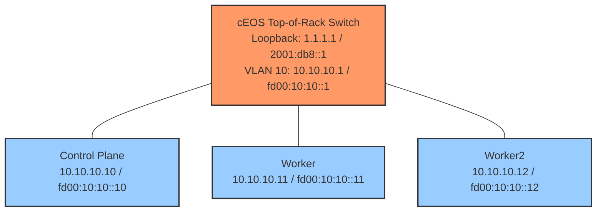
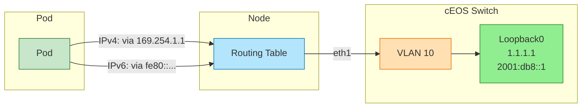
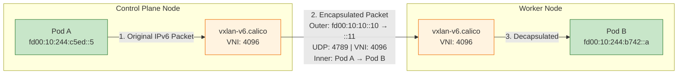

Calico IPv4 and IPv6协议 -- 双栈网络技术，在这种架构下，容器可以通过IPv4和IPv6两种协议进行通信，从而实现访问内部服务以及外部目标。

## 概述
- 如何使用Calico工具配置一个带有双栈架构的kubernetes集群
- Pod如何同时接收IPv4和IPv6地址?
- VXLAN封装如何实现IPv6节点间的通信
- 如何让Pod能够访问外部的IPv4和IPv6地址
- CoreDNS如何为服务提供A(IPv4)和AAAA(IPv6)记录

## 什么是双栈网络
双栈网络意味着网络实体（节点、Pod、服务）同时拥有IPv4和IPv6地址，这使得应用程序能够：
- 使用IPv4协议与传统系统进行通信
- 利用现代基础设施，通过IPv6进行通信
- 逐步从IPv4过渡到IPv6，同时避免破坏兼容性
在这个实验中，这些Pod能够在上游路由器上同时到达IPv4 1.1.1.1 和 IPv6地址 20001:db8::1， 从而实现真正的双栈外部连接功能。


## kind集群中双栈网络配置

### 集群配置
为了在kubernetes中实现双栈网络功能，需要在创建集群时对其进行配置，kind集群配置文件(dual-stack-no-cni.yaml)
```yaml
# Kind cluster configuration for Dual-Stack networking
# Pods and services get both IPv4 and IPv6 addresses

apiVersion: kind.x-k8s.io/v1alpha4
kind: Cluster
name: dual-stack
networking:
  disableDefaultCNI: true
  # Dual-stack pod subnets
  podSubnet: "192.168.0.0/16,fd00:10:244::/48"
  # Dual-stack service subnets  
  serviceSubnet: "10.96.0.0/16,fd00:10:96::/112"
  # enable dual-stack both IPv4 and IPv6
  ipFamily: dual

```

配置字段解析：

| Setting             | Value                             | Description                                          |
| ------------------- | --------------------------------- | ---------------------------------------------------- |
| `disableDefaultCNI` | `true`                            | Disables Kind's default CNI so we can install Calico |
| `podSubnet`         | `192.168.0.0/16,fd00:10:244::/48` | Comma-separated IPv4 and IPv6 CIDRs for pods         |
| `serviceSubnet`     | `10.96.0.0/16,fd00:10:96::/112`   | Comma-separated IPv4 and IPv6 CIDRs for services     |
| `ipFamily`          | `dual`                            | Enables dual-stack mode (both IPv4 and IPv6)         |

### 节点IP配置
每个节点必须配置为向Kubernetes API 公告 Pv4和IPv6地址信息

```yaml
nodes:
  - role: control-plane
    kubeadmConfigPatches:
      - |
        kind: InitConfiguration
        nodeRegistration:
          kubeletExtraArgs:
            node-ip: "10.10.10.10,fd00:10:10::10"

  - role: worker
    kubeadmConfigPatches:
      - |
        kind: JoinConfiguration
        nodeRegistration:
          kubeletExtraArgs:
            node-ip: "10.10.10.11,fd00:10:10::11"

  - role: worker
    kubeadmConfigPatches:
      - |
        kind: JoinConfiguration
        nodeRegistration:
          kubeletExtraArgs:
            node-ip: "10.10.10.12,fd00:10:10::12"
```

`node-ip` 参数是一个以逗号分隔的列表，包含节点的IPv4地址和IPv6地址。这样就能让kubectl同时向API服务注册这两种地址，从而实现以下功能：
- 节点上拥有双栈地址
- 对双栈Pod的正确调度
- 对Service endpoint的正确选择

## 为什么这些设置很重要
1. `ipFamily: dual` —— 如果没有这个设置，Kubernetes 默认是单栈（仅 IPv4）
2. **逗号分隔的子网** —— 顺序很重要：IPv4 在前，IPv6 在后
3. **每个节点上的** **`node-ip`** —— 确保 kubelet 注册两个地址；否则节点可能只通告一种地址族

>**重要提示：** 双栈必须在集群创建时配置。集群创建后，无法将单栈集群转换为双栈。

## Calico IP池配置
在集群创建完成后，会安装双栈IP池的Calico CNI。

```yaml
apiVersion: operator.tigera.io/v1
kind: Installation
metadata:
  name: default
spec:
  calicoNetwork:
    ipPools:
      # IPv4 IP Pool for pods
      - name: default-ipv4-ippool
        blockSize: 26
        cidr: 192.168.0.0/16
        encapsulation: VXLANCrossSubnet
        natOutgoing: Enabled
        nodeSelector: all()

      # IPv6 IP Pool for pods
      - name: default-ipv6-ippool
        blockSize: 122
        cidr: fd00:10:244::/48
        encapsulation: VXLAN
        natOutgoing: Enabled
        nodeSelector: all()

    # Node address auto-detection (uses eth1 addresses)
    nodeAddressAutodetectionV4:
      cidrs:
        - 10.10.10.0/24
    nodeAddressAutodetectionV6:
      cidrs:
        - fd00:10:10::/64
```

|   |   |   |   |
|---|---|---|---|
|**设置（Setting）**|**IPv4 池（IPv4 Pool）**|**IPv6 池（IPv6 Pool）**|**说明（Description）**|
|**CIDR**|`192.168.0.0/16`|`fd00:10:244::/48`|Pod 的地址范围|
|**块大小（Block Size）**|`/26`（64 个 IP）|`/122`（64 个 IP）|每个节点的分配大小|
|**封装（Encapsulation）**|`VXLANCrossSubnet`|`VXLAN`|Pod 流量的隧道封装方式|
|**NAT Outgoing**|已启用|已启用|对外部流量的 SNAT|

## 节点地址检测
Calico需要知道用于VXLAN隧道的节点IP是什么：

|   |   |   |
|---|---|---|
|**设置（Setting）**|**CIDR**|**用途（Purpose）**|
|`nodeAddressAutodetectionV4`|`10.10.10.0/24`|对 IPv4 VXLAN 使用 eth1 上的 IPv4 地址|
|`nodeAddressAutodetectionV6`|`fd00:10:10::/64`|对 IPv6 VXLAN 使用 eth1 上的 IPv6 地址|
这样能确保Calico使用eth1接口(连接到cEOS交换机)，而不是默认的Docker网络接口

## 实验topo结构


- 节点通过eth1以双栈地址(IPv4+IPv6)连接到ToR交换机。
- Pod同时拥有IPv4(`192.168.x.x`)和IPv6( `fd00:10:244: :x` )地址
- 外部连通性：Pod 能够向ToR环回口上的 `1.1.1.1` (IPv4)和 `2001:db8::1` (IPv6) 发送数据包(能ping通)
- 内部连通性：Pod-to-Pod的IPv6通信使用VXLAN封装

```
                    ┌─────────────────────────────────────────────────────┐
                    │              Arista cEOS Switch                     │
                    │                                                     │
                    │  VLAN 10 Interface:                                 │
                    │    IPv4: 10.10.10.1/24                              │
                    │    IPv6: fd00:10:10::1/64                           │
                    │                                                     │
                    │  Loopback0 (External Destination):                  │
                    │    IPv4: 1.1.1.1/32                                 │
                    │    IPv6: 2001:db8::1/128                            │
                    │                                                     │
                    └───────┬─────────────┬─────────────┬─────────────────┘
                            │ eth1        │ eth2        │ eth3
                            │             │             │
        ┌───────────────────┴───┐   ┌─────┴─────┐   ┌───┴───────────────────┐
        │  Control Plane        │   │  Worker   │   │  Worker2              │
        │                       │   │           │   │                       │
        │  eth1:                │   │  eth1:    │   │  eth1:                │
        │  IPv4: 10.10.10.10    │   │  10.10.   │   │  IPv4: 10.10.10.12    │
        │  IPv6: fd00:10:10::10 │   │  10.11    │   │  IPv6: fd00:10:10::12 │
        │                       │   │  fd00:    │   │                       │
        │  Pod CIDR:            │   │  10:10::  │   │  Pod CIDR:            │
        │  192.168.x.0/26 (v4)  │   │  11       │   │  192.168.x.0/26 (v4)  │
        │  fd00:10:244::/122(v6)│   │           │   │  fd00:10:244::/122(v6)│
        └───────────────────────┘   └───────────┘   └───────────────────────┘
```


### 网络配置摘要

| Component            | IPv4 Address   | IPv6 Address      |
| -------------------- | -------------- | ----------------- |
| cEOS VLAN 10         | 10.10.10.1/24  | fd00:10:10::1/64  |
| cEOS Loopback0       | 1.1.1.1/32     | 2001:db8::1/128   |
| Control Plane (eth1) | 10.10.10.10/24 | fd00:10:10::10/64 |
| Worker (eth1)        | 10.10.10.11/24 | fd00:10:10::11/64 |
| Worker2 (eth1)       | 10.10.10.12/24 | fd00:10:10::12/64 |
| Pod Network          | 192.168.0.0/16 | fd00:10:244::/48  |
| Service Network      | 10.96.0.0/16   | fd00:10:96::/112  |

## 资源清单
### conatinerlab 配置
```yaml
# ContainerLab topology for Dual-Stack Lab
# 3-node Kind cluster connected to Arista cEOS switch
# Demonstrates pods reaching external IPv4 and IPv6 destinations

name: dual-stack
topology:
  nodes:
    # Arista cEOS switch - acts as upstream router
    ceos01:
      kind: arista_ceos
      image: ceos:4.34.0F
      startup-config: startup-configs/ceos01-startup-config.config

    # Kind cluster with 3 nodes
    dual-stack:
      kind: k8s-kind
      startup-config: dual-stack-no-cni.yaml
      extras:
        k8s_kind:
          deploy:
            wait: 0s

    # External container configs - add eth1 interface with IPv4+IPv6
    dual-stack-control-plane:
      kind: ext-container
      exec:
        # IPv4 address on eth1
        - "ip addr add dev eth1 10.10.10.10/24"
        # IPv6 address on eth1
        - "ip -6 addr add dev eth1 fd00:10:10::10/64"
        # IPv4 default route via cEOS (for external IPv4)
        - "ip route add 1.1.1.1/32 via 10.10.10.1 dev eth1"
        # IPv6 default route via cEOS (for external IPv6)
        - "ip -6 route add 2001:db8::/32 via fd00:10:10::1 dev eth1"

    dual-stack-worker:
      kind: ext-container
      exec:
        - "ip addr add dev eth1 10.10.10.11/24"
        - "ip -6 addr add dev eth1 fd00:10:10::11/64"
        - "ip route add 1.1.1.1/32 via 10.10.10.1 dev eth1"
        - "ip -6 route add 2001:db8::/32 via fd00:10:10::1 dev eth1"

    dual-stack-worker2:
      kind: ext-container
      exec:
        - "ip addr add dev eth1 10.10.10.12/24"
        - "ip -6 addr add dev eth1 fd00:10:10::12/64"
        - "ip route add 1.1.1.1/32 via 10.10.10.1 dev eth1"
        - "ip -6 route add 2001:db8::/32 via fd00:10:10::1 dev eth1"

  # Network links between cEOS and Kind nodes
  links:
    - endpoints: ["ceos01:eth1", "dual-stack-control-plane:eth1"]
    - endpoints: ["ceos01:eth2", "dual-stack-worker:eth1"]
    - endpoints: ["ceos01:eth3", "dual-stack-worker2:eth1"]
```

### calico 配置
```yaml
# Calico Installation with Dual-Stack (IPv4 + IPv6) networking
# - VXLAN for pod-to-pod communication (works over IPv4 infrastructure)
# - Native IPv6 routing for external destinations (via node's eth1)

apiVersion: operator.tigera.io/v1
kind: Installation
metadata:
  name: default
spec:
  calicoNetwork:
    ipPools:
      # IPv4 IP Pool for pods
      - name: default-ipv4-ippool
        blockSize: 26
        cidr: 192.168.0.0/16
        encapsulation: VXLANCrossSubnet
        natOutgoing: Enabled
        nodeSelector: all()

      # IPv6 IP Pool for pods
      # Using VXLAN for pod-to-pod, but external IPv6 goes via native routing
      - name: default-ipv6-ippool
        blockSize: 122
        cidr: fd00:10:244::/48
        encapsulation: VXLAN
        natOutgoing: Enabled
        nodeSelector: all()

    # Node address auto-detection
    # Uses eth1 addresses (connected to cEOS) for node identification
    nodeAddressAutodetectionV4:
      cidrs:
        - 10.10.10.0/24

    nodeAddressAutodetectionV6:
      cidrs:
        - fd00:10:10::/64

---

apiVersion: operator.tigera.io/v1
kind: APIServer
metadata:
  name: default
spec: {}
```

### 交换机配置

```
! Arista cEOS startup configuration for Dual-Stack Lab
! This switch acts as the upstream router with both IPv4 and IPv6 connectivity
!
hostname ceos-dualstack
!
! Enable IPv6 routing globally
ipv6 unicast-routing
!
! Define VLAN 10 for Kubernetes node connectivity
!
vlan 10
   name K8s-DualStack-Network
!
! Configure interfaces as access ports in VLAN 10
!
interface Ethernet1
   description Connection to dual-stack-control-plane
   switchport mode access
   switchport access vlan 10
!
interface Ethernet2
   description Connection to dual-stack-worker
   switchport mode access
   switchport access vlan 10
!
interface Ethernet3
   description Connection to dual-stack-worker2
   switchport mode access
   switchport access vlan 10
!
! Layer 3 interface for VLAN 10 - Gateway for K8s nodes
! This is the default gateway for both IPv4 and IPv6 traffic from nodes
!
interface Vlan10
   description K8s Nodes Gateway (Dual-Stack)
   ip address 10.10.10.1/24
   ipv6 address fd00:10:10::1/64
!
! Loopback interface - Simulates an external destination
! Pods will ping this to demonstrate external dual-stack connectivity
!
interface Loopback0
   description External Destination (Dual-Stack)
   ip address 1.1.1.1/32
   ipv6 address 2001:db8::1/128
!
! Enable IP routing
!
ip routing
ipv6 routing
!
! Static routes to pod CIDRs via K8s nodes
! These allow the switch to route return traffic back to pods
!
ip route 192.168.0.0/16 10.10.10.10
ipv6 route fd00:10:244::/48 fd00:10:10::10
!
! Management interface
!
interface Management0
   ip address dhcp
   no shutdown
!
! User configuration
!
username admin privilege 15 secret admin
!
! Enable HTTP API
!
management api http-commands
   no shutdown
!
end
```

## 环境检查

### 检查containerlab 拓扑结构
```bash
> containerlab inspect -t topology.clab.yaml
18:16:09 INFO Parsing & checking topology file=topology.clab.yaml
╭──────────────────────────┬──────────────────────┬─────────┬───────────────────────╮
│           Name           │      Kind/Image      │  State  │     IPv4/6 Address    │
├──────────────────────────┼──────────────────────┼─────────┼───────────────────────┤
│ dual-stack-control-plane │ ext-container        │ running │ 172.18.0.4            │
│                          │ kindest/node:v1.35.0 │         │ fc00:f853:ccd:e793::4 │
├──────────────────────────┼──────────────────────┼─────────┼───────────────────────┤
│ dual-stack-worker        │ ext-container        │ running │ 172.18.0.3            │
│                          │ kindest/node:v1.35.0 │         │ fc00:f853:ccd:e793::3 │
├──────────────────────────┼──────────────────────┼─────────┼───────────────────────┤
│ dual-stack-worker2       │ ext-container        │ running │ 172.18.0.2            │
│                          │ kindest/node:v1.35.0 │         │ fc00:f853:ccd:e793::2 │
├──────────────────────────┼──────────────────────┼─────────┼───────────────────────┤
│ clab-dual-stack-ceos01   │ arista_ceos          │ running │ 172.20.20.2           │
│                          │ ceos:4.34.0F         │         │ 3fff:172:20:20::2     │
├──────────────────────────┼──────────────────────┼─────────┼───────────────────────┤
│ dual-stack-control-plane │ k8s-kind             │ running │ 172.18.0.4            │
│                          │ kindest/node:v1.35.0 │         │ fc00:f853:ccd:e793::4 │
├──────────────────────────┼──────────────────────┼─────────┼───────────────────────┤
│ dual-stack-worker        │ k8s-kind             │ running │ 172.18.0.3            │
│                          │ kindest/node:v1.35.0 │         │ fc00:f853:ccd:e793::3 │
├──────────────────────────┼──────────────────────┼─────────┼───────────────────────┤
│ dual-stack-worker2       │ k8s-kind             │ running │ 172.18.0.2            │
│                          │ kindest/node:v1.35.0 │         │ fc00:f853:ccd:e793::2 │
╰──────────────────────────┴──────────────────────┴─────────┴───────────────────────╯
```

### 检查节点状态
```bash
> kubectl get pod -o wide
NAME              READY   STATUS    RESTARTS   AGE     IP                NODE                       NOMINATED NODE   READINESS GATES
multitool-hf6mw   1/1     Running   0          4h27m   192.168.183.72    dual-stack-worker2         <none>           <none>
multitool-hn5pr   1/1     Running   0          4h27m   192.168.207.194   dual-stack-control-plane   <none>           <none>
multitool-kp42f   1/1     Running   0          4h27m   192.168.77.2      dual-stack-worker          <none>           <none>
```

### 确认节点上双栈地址是否正确
每个节点在eth1接口上都同时有用IPv4和IPv6地址(该接口连接了cEOS交换机)
```bash
> docker exec dual-stack-control-plane ip addr show  eth1
8: eth1@if9: <BROADCAST,MULTICAST,UP,LOWER_UP> mtu 9500 qdisc noqueue state UP group default 
    link/ether aa:c1:ab:f5:a4:07 brd ff:ff:ff:ff:ff:ff link-netnsid 1
    altname clab-o-037ec490d94d6c5d
    inet 10.10.10.10/24 scope global eth1
       valid_lft forever preferred_lft forever
    inet6 fd00:10:10::10/64 scope global 
       valid_lft forever preferred_lft forever
    inet6 fe80::a8c1:abff:fef5:a407/64 scope link 
       valid_lft forever preferred_lft forever
```

#### 理解IPv6地址范围
从eth1的输出来看，你会发现两种不同类型的IPv6地址，他们的范围各不相同：

| Scope      | Example                  | Routable? | Description                                               |
| ---------- | ------------------------ | --------- | --------------------------------------------------------- |
| **global** | `fd00:10:10::10/64`      | ✅ Yes     | Manually configured, used for routing across networks     |
| **link**   | `fe80::a8c1:abff:.../64` | ❌ No      | Auto-generated from MAC address, only valid on local link |
- scope global: 全局范围，这是我们自己配置的地址，他用于实际的通信过程-当Pod将流量发送到外部IPv6地址时，就会使用这个地址作为源地址。
- scope link: 由内核在每个支持IPv6的接口上自动生成。仅用于邻居发现和数据本地通信目的（类似于IPv4中的 `169.254.x.x`）

## 检查IP地址池

```bash
> calicoctl get ippools -o wide
NAME                  CIDR               NAT    IPIPMODE   VXLANMODE     DISABLED   DISABLEBGPEXPORT   SELECTOR   ASSIGNMENTMODE   
default-ipv4-ippool   192.168.0.0/16     true   Never      CrossSubnet   false      false              all()      Automatic        
default-ipv6-ippool   fd00:10:244::/48   true   Never      Always        false      false              all()      Automatic 
```

## 检查Pod的双栈地址配置
```bash
> calicoctl get workloadendpoints -o wide
NAME                                                    WORKLOAD          NODE                       NETWORKS                                                      INTERFACE         PROFILES                          NATS   
dual--stack--worker2-k8s-multitool--hf6mw-eth0          multitool-hf6mw   dual-stack-worker2         192.168.183.72/32,fd00:10:244:b742:2d01:58:8f51:b008/128      cali10761db0f92   kns.default,ksa.default.default          
dual--stack--control--plane-k8s-multitool--hn5pr-eth0   multitool-hn5pr   dual-stack-control-plane   192.168.207.194/32,fd00:10:244:c5ed:ff89:5a77:afb2:cfc2/128   calic24650be8af   kns.default,ksa.default.default          
dual--stack--worker-k8s-multitool--kp42f-eth0           multitool-kp42f   dual-stack-worker          192.168.77.2/32,fd00:10:244:1b38:1133:7e2c:be1e:4d02/128      cali4649a5c434d   kns.default,ksa.default.default
```
可以发现每个Pod在NETWORKS列都同时有用IPV4和IPv6地址

## 测试外部IPv4连接性
双栈网络中的服务既能通过IPv4也能通IPv6协议达到外部目标地址。
从Pod中ping cEOS的lopback IPv4地址
```bash
> kubectl exec -it multitool-hf6mw -- ping -c 3 1.1.1.1
PING 1.1.1.1 (1.1.1.1) 56(84) bytes of data.
64 bytes from 1.1.1.1: icmp_seq=1 ttl=63 time=2.31 ms
64 bytes from 1.1.1.1: icmp_seq=2 ttl=63 time=0.693 ms
64 bytes from 1.1.1.1: icmp_seq=3 ttl=63 time=0.681 ms

--- 1.1.1.1 ping statistics ---
3 packets transmitted, 3 received, 0% packet loss, time 2022ms
rtt min/avg/max/mdev = 0.681/1.227/2.308/0.764 ms
 ~   
```

## 测试外部IPv6连接性
从Pod节点ping cEOS的loopback Ipv6地址

```bash
> kubectl exec -it multitool-hf6mw -- ping6 -c 3 2001:db8::1
PING 2001:db8::1(2001:db8::1) 56 data bytes
64 bytes from 2001:db8::1: icmp_seq=1 ttl=63 time=2.22 ms
64 bytes from 2001:db8::1: icmp_seq=2 ttl=63 time=0.746 ms
64 bytes from 2001:db8::1: icmp_seq=3 ttl=63 time=0.708 ms

--- 2001:db8::1 ping statistics ---
3 packets transmitted, 3 received, 0% packet loss, time 2020ms
rtt min/avg/max/mdev = 0.708/1.224/2.219/0.703 ms
 ~    
```
成功了！这个 Pod 能够访问 IPv4 地址 1.1.1.1 和 IPv6 地址 2001:db8::1 这两个外部目标，证明了其真正的双栈连接能力。

## 外部连接工作原理

### IPv4路径(Pod->1.1.1.1)
```bash
Pod (192.168.x.x) 
    → default route via 169.254.1.1 (Calico gateway)
    → Node routing table
    → Static route: 1.1.1.1 via 10.10.10.1 (eth1)
    → cEOS VLAN 10 interface (10.10.10.1)
    → cEOS Loopback0 (1.1.1.1) ✓
```

### IPv6路径(Pod->`2001:db8: :1`)

```bash
Pod (fd00:10:244::x)
    → default IPv6 route via fe80::... (Calico gateway)
    → Node routing table
    → Static route: 2001:db8::/32 via fd00:10:10::1 (eth1)
    → cEOS VLAN 10 interface (fd00:10:10::1)
    → cEOS Loopback0 (2001:db8::1) ✓
```

## 测试pod之间IPv6连接性
pod-to-pod通信使用节点的IPv4基础设施，进行VXLAN封装技术来实现

```bash
> calicoctl get workloadendpoints -o wide
NAME                                                    WORKLOAD          NODE                       NETWORKS                                                      INTERFACE         PROFILES                          NATS   
dual--stack--worker2-k8s-multitool--hf6mw-eth0          multitool-hf6mw   dual-stack-worker2         192.168.183.72/32,fd00:10:244:b742:2d01:58:8f51:b008/128      cali10761db0f92   kns.default,ksa.default.default          
dual--stack--control--plane-k8s-multitool--hn5pr-eth0   multitool-hn5pr   dual-stack-control-plane   192.168.207.194/32,fd00:10:244:c5ed:ff89:5a77:afb2:cfc2/128   calic24650be8af   kns.default,ksa.default.default          
dual--stack--worker-k8s-multitool--kp42f-eth0           multitool-kp42f   dual-stack-worker          192.168.77.2/32,fd00:10:244:1b38:1133:7e2c:be1e:4d02/128      cali4649a5c434d   kns.default,ksa.default.default          

> kubectl exec -it multitool-hf6mw -- ping6 -c 3 fd00:10:244:c5ed:ff89:5a77:afb2:cfc2
PING fd00:10:244:c5ed:ff89:5a77:afb2:cfc2(fd00:10:244:c5ed:ff89:5a77:afb2:cfc2) 56 data bytes
64 bytes from fd00:10:244:c5ed:ff89:5a77:afb2:cfc2: icmp_seq=1 ttl=62 time=0.860 ms
64 bytes from fd00:10:244:c5ed:ff89:5a77:afb2:cfc2: icmp_seq=2 ttl=62 time=0.905 ms
64 bytes from fd00:10:244:c5ed:ff89:5a77:afb2:cfc2: icmp_seq=3 ttl=62 time=0.582 ms

--- fd00:10:244:c5ed:ff89:5a77:afb2:cfc2 ping statistics ---
3 packets transmitted, 3 received, 0% packet loss, time 2048ms
rtt min/avg/max/mdev = 0.582/0.782/0.905/0.142 ms
 ~            
```
我们使用一个pod去ping6另外一个pod的IPv6地址，可以发祥数据是通的

## 双栈服务
### 检查服务状态
标准的 `kubectl get svc` 命令只显示IPv4地址，即主ClusterIP地址。要查看IPv4和IPv6地址，请使用以下命令：
```bash
> kubectl get svc -o custom-columns='NAME:.metadata.name,TYPE:.spec.type,CLUSTER-IPs:.spec.clusterIPs,PORTS:.spec.ports[*].port'
NAME                   TYPE        CLUSTER-IPs                       PORTS
kubernetes             ClusterIP   [10.96.0.1]                       443
multitool-dual-stack   ClusterIP   [10.96.119.15 fd00:10:96::b603]   80
multitool-ipv6-only    ClusterIP   [fd00:10:96::34fe]                80
```

你还可以查看特定服务的IP家族信息
```bash
> kubectl get svc multitool-dual-stack -o yaml | grep -A5 "clusterIPs\|ipFamilies"
  clusterIPs:
  - 10.96.119.15
  - fd00:10:96::b603
  internalTrafficPolicy: Cluster
  ipFamilies:
  - IPv4
  - IPv6
  ipFamilyPolicy: RequireDualStack
  ports:
  - port: 80
```

### DNS解析
CoreDNS同时提供A Record(IPv4)和AAAA Record(IPv6)
```bash
# 查询 IPv4 DNS record
> kubectl exec -it $(kubectl get pods -l app=multitool -o name | head -1) -- dig multitool-dual-stack.default.svc.cluster.local A +short
10.96.119.15
# 查询 IPv6 DNS record
> kubectl exec -it $(kubectl get pods -l app=multitool -o name | head -1) -- dig multitool-dual-stack.default.svc.cluster.local AAAA +short
fd00:10:96::b603
```

### 按域名访问服务
```bash
> kubectl exec -it $(kubectl get pods -l app=multitool -o name | head -1) -- sh
# 通过 IPv4访问服务 A Record
/ # curl http://multitool-dual-stack
Dual-Stack Pod - IPv4 and IPv6 enabled
# 指定使用 IPv6 地址访问服务
/ # curl -6 http://multitool-dual-stack
Dual-Stack Pod - IPv4 and IPv6 enabled
# 访问 只有 IPv6 地址的服务，默认走 IPv6 
/ # curl http://multitool-ipv6-only
Dual-Stack Pod - IPv4 and IPv6 enabled
```

## 附加说明
### 双栈流量

|Traffic Type|Path|Encapsulation|
|---|---|---|
|Pod → Pod (same node)|veth pair|None|
|Pod → Pod (different node, IPv4)|vxlan.calico|IPv4-in-IPv4 VXLAN|
|Pod → Pod (different node, IPv6)|vxlan-v6.calico|IPv6-in-IPv6 VXLAN|
|Pod → External IPv4|Node eth1 → cEOS|None (native)|
|Pod → External IPv6|Node eth1 → cEOS|None (native)|
|Pod → Service (IPv4)|kube-proxy/iptables|DNAT to pod|
|Pod → Service (IPv6)|kube-proxy/ip6tables|DNAT to pod|
### 为什么选择VXLAN来实现pod-to-pod通信
VXLAN技术将Pod 的 IPv6数据包封装起来，以便在节点之间传输，这实现了以下功能：
- Pod-to-pod IPv6通信
- 对于内部流量来说，无需再节点之间实现本地IPv6路由处理

## 理解IPv6 VXLAN路由技术
Calico IPv6 流量创建了一个独立的VXLAN隧道，该隧道的名称是`vxlan-v6.calico`。这个隧道使用节点的IPv6地址作为外部头部信息，这些地址是通过 `nodeAddressAutodetectionV6` 配置得到的。

### VXLAN 接口详细信息
```bash
> docker exec dual-stack-control-plane ip -d link show vxlan-v6.calico
3: vxlan-v6.calico: <BROADCAST,MULTICAST,UP,LOWER_UP> mtu 1430 qdisc noqueue state UNKNOWN mode DEFAULT group default qlen 1000
    link/ether 66:ea:8e:de:57:b9 brd ff:ff:ff:ff:ff:ff promiscuity 0  allmulti 0 minmtu 68 maxmtu 65535 
    vxlan id 4096 local fd00:10:10::10 dev eth1 srcport 0 0 dstport 4789 nolearning ttl auto ageing 300 udpcsum noudp6zerocsumtx noudp6zerocsumrx addrgenmode eui64 numtxqueues 1 numrxqueues 1 gso_max_size 65536 gso_max_segs 65535 tso_max_size 524280 tso_max_segs 65535 gro_max_size 65536 
```

|Field|Value|Description|
|---|---|---|
|`vxlan id 4096`|VNI|VXLAN Network Identifier for IPv6 traffic|
|`local fd00:10:10::10`|VTEP|Local tunnel endpoint - the node's IPv6 address|
|`dev eth1`|Underlay|The physical interface used for the tunnel|
|`dstport 4789`|Port|Standard VXLAN UDP port|
|`mtu 1430`|MTU|Reduced from 1500 to account for VXLAN overhead|
### 通过VXLAN实现 IPv6路由
通往其他容器子网的路由铜鼓VXLAN接口进行传输
```bash
> docker exec dual-stack-control-plane ip -6 route |grep vxlan-v6
fd00:10:244:1b38:1133:7e2c:be1e:4d00 dev vxlan-v6.calico metric 1024 pref medium
fd00:10:244:1b38:1133:7e2c:be1e:4d00/122 via fd00:10:244:1b38:1133:7e2c:be1e:4d00 dev vxlan-v6.calico metric 1024 onlink pref medium
fd00:10:244:b742:2d01:58:8f51:b000 dev vxlan-v6.calico metric 1024 pref medium
fd00:10:244:b742:2d01:58:8f51:b000/122 via fd00:10:244:b742:2d01:58:8f51:b000 dev vxlan-v6.calico metric 1024 onlink pref medium
```
这些 `/122` 块是分配给工作节点的 IPv6 子网 CIDR 地址。通往这些子网的数据包会经过 `vxlan-v6.calico` 进行封装处理。

### IPv6邻居表
邻居表将远程节点的子网网关地址映射到了对应的MAC地址上：

```bash
> docker exec dual-stack-control-plane ip -6 neigh show dev vxlan-v6.calico
fd00:10:244:1b38:1133:7e2c:be1e:4d00 lladdr 66:ee:a7:ef:78:65 PERMANENT 
fd00:10:244:b742:2d01:58:8f51:b000 lladdr 66:52:6a:03:c1:3b PERMANENT 
```
当数据包与通过 `vxlan-v6.calico` 的路由匹配时，内核会在邻居表中查找下一跳的 IPv6 地址，以获取目标 MAC 地址。

### Forwarding Database (FDB) Entries - 转发数据库条目(FDB)
FDB系统会告知VXLAN接口应当将封装后的数据包发送到哪个远程节点上：
```bash
> docker exec dual-stack-control-plane bridge fdb show dev vxlan-v6.calico
66:52:6a:03:c1:3b dst fd00:10:10::12 self permanent
66:ee:a7:ef:78:65 dst fd00:10:10::11 self permanent
> 
```
每个条目都将mac地址和远程IPv6地址进行一一匹配。FDB则是最终的查找目标-它决定封装在VXLAN协议中的数据包的外层IPv6目的地。

### IPv6 VXLAN的工作原理


- calico在VXLAN隧道的传输过程中，同时使用IPv6作为头部和外部头部
- 每个节点的 `vxlan-v6.calico` 接口都拥有属于自己的IPv6地址，这些地址来自Pod的CIDR范围
- FDB功能负责将Pod子网与节点IPv6地址之间的映射关系进行关联
- 与IPv4节点流量的IPv4 VXLAN是分开的独立的

## 为什么选择本地路由来处理外部请求呢？
外部目的地(如cEOS loopback)需要基于原生IPv6路由功能，因为：
- 目的地位于Pod网络之外
- VXLAN仅适用于封装节点之间的流量传输
- 节点需要IPv6地址和路由，以便将数据包发送出去
## 应用需要支持IPv6
为了让IPv6服务能够正常运行，你的应用程序必须支持IPv6地址。许多应用程序默认只是用IPv4地址(`0.0.0.0`)。

```bash
# Check if your app is listening on IPv6 
kubectl exec -it <pod> -- netstat -tlnp 
# Look for :::port entries (IPv6) vs 0.0.0.0:port (IPv4 only)
```

## cEOS交换机配置
cEOS交换机配置重点说明
- VLAN10 连接所有k8s节点
- Loopback0:通过IPv4和IPv6两种地址格式来模拟外部目标地址
- 静态路由：将集群内部的流量引导会集群本身

### 验证cEOS配置是否都正确

```
docker exec -it clab-dual-stack-ceos01 Cli
```

```
enable
show ip interface brief
show ipv6 interface brief
show ip route
show ipv6 route
```


## 总结

1. **Dual-stack pod addressing** - Each pod receives both IPv4 and IPv6 addresses  
    双栈容器寻址方式 - 每个容器同时接收 IPv4 和 IPv6 地址
2. **Separate VXLAN tunnels** - Calico creates `vxlan.calico` (IPv4) and `vxlan-v6.calico` (IPv6) for pod-to-pod traffic  
    独立的 VXLAN 隧道——Calico 会为节点间的流量创建 `vxlan.calico` （IPv4）和 `vxlan-v6.calico` （IPv6）两种隧道。
3. **Native routing for external** - Pods reach external IPv4/IPv6 via node routing  
    针对外部 Pod 的本地路由机制，使得它们能够通过节点路由访问外部 IPv4/IPv6 地址。
4. **Dual-stack services** - Services can have both IPv4 and IPv6 ClusterIPs  
    双栈服务 – 这些服务可以同时支持 IPv4 和 IPv6 的 ClusterIP 地址。
5. **DNS support** - CoreDNS provides A and AAAA records for services  
    DNS 支持 - CoreDNS 为服务提供 A 记录和 AAAA 记录

The key takeaway is that **dual-stack networking allows pods to communicate over both IPv4 and IPv6**, enabling gradual migration from IPv4 to IPv6 while maintaining backward compatibility.  
关键的点是，双栈网络使得容器能够同时通过 IPv4 和 IPv6 进行通信，从而可以在不破坏向后兼容性的情况下，逐步迁移从 IPv4 到 IPv6 的通信方式。


