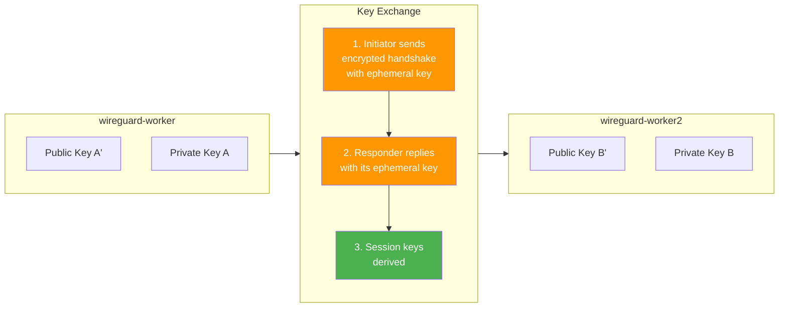

WireGuard 加密技术，该功能可用于保护节点之间流量安全，通过抓捕数据包你可以清楚的看到，未加密流量和加密流量之间的区别。

## 概述
在kubernetes环境中，节点之间的流量是通过物理网络基础设施进行传输的。如果不进行加密处理，这些流量就很容易受到以下威胁：
- 窃听：网络管理员或攻击者可以截获并读取数据包中的信息
- 中间人攻击：数据流量可以截获和篡改
- 合规性违规：许多法规要求对传输中的数据进行加密处理

Calico的WireGuard具有以下功能：

| Feature  特色功能                        | Benefit  好处                                                |
| ------------------------------------ | ---------------------------------------------------------- |
| **Transparent Encryption  透明加密**     | No application changes required  <br>无需对应用程序进行任何更改。        |
| **High Performance  高性能**            | WireGuard is faster than IPsec  <br>WireGuard 比 IPsec 更快。  |
| **Simple Configuration  简单配置**       | Enable with a single command  <br>只需一个命令即可启用               |
| **Automatic Key Management  自动密钥管理** | Wireguard handles key rotation  <br>Wireguard 负责处理密钥的轮换工作。 |
## WireGuard 如何与Calico协同工作
当启用WireGuard时：
1. 密钥生成：每个节点都会生成一对WireGuard密钥
2. 对等节点发现：Calico会自动在各个节点之间配置WireGuard对等连接
3. 隧道创建：每个节点上都会创建一个wireguard.cali接口
4. 流量加密：节点之间所有Pod间的流量均通过UDP端口51820进行加密传输。

**Without WireGuard:**
```
Pod A (Node 1) → [Plain/VXLAN packet] → Physical Network → [Plain/VXLAN packet] → Pod B (Node 2)
                     ↑ Readable by anyone on the network
```

**With WireGuard:**
```
Pod A (Node 1) → [Encrypted WireGuard packet] → Physical Network → [Encrypted packet] → Pod B (Node 2)
                     ↑ Encrypted - unreadable without keys
```

## WireGuard 密钥交换与加密机制
WireGuard 采用了现代加密技术以及简单的密钥交换机制。了解这些原理有助于理解节点之间如何进行加密和解密操作。

关键点：

| Key Type            | Purpose  目的                                                                             | Storage  存储                                              |
| ------------------- | --------------------------------------------------------------------------------------- | -------------------------------------------------------- |
| **Private Key  私钥** | Used to decrypt incoming traffic and sign outgoing traffic  <br>用于解密传入数据，并对传出的数据进行加密处理。 | Kept secret on the node  <br>在节点上被保密了                    |
| **Public Key  公钥**  | Shared with peers to encrypt traffic destined for this node  <br>与同伴共享，以加密发往该节点的数据流量    | Distributed via Calico datastore  <br>通过 Calico 数据存储进行分发 |
```
┌─────────────────────────────────────────────────────────────────────────┐
│                     KEY PAIRS PER NODE                                   │
├─────────────────────────────────────────────────────────────────────────┤
│                                                                          │
│   wireguard-worker                        wireguard-worker2              │
│  ┌────────────────────┐                 ┌────────────────────┐           │
│  │ Private Key: [A]   │                 │ Private Key: [B]   │           │
│  │ (kept secret)      │                 │ (kept secret)      │           │
│  │                    │                 │                    │           │
│  │ Public Key: [A']   │◄───────────────►│ Public Key: [B']   │           │
│  │ (shared with peers)│   Key Exchange  │ (shared with peers)│           │
│  └────────────────────┘                 └────────────────────┘           │
│                                                                          │
└─────────────────────────────────────────────────────────────────────────┘
```

### 密钥交换式如何工作的
WireGuard在密钥交换过程中使用了Noise Protocol Framework协议（具体来说是Noise_IKpsk2协议）
1. 静态密钥：每个节点都会生成一对长期有效的密钥对(Curve25519)
2. 临时密钥：在每次握手过程中，都会生成用于确保通信安全性的临时密钥
3. 会话密钥：在握手过程中，会生成用于实际数据加密的对称会话密钥





### 加密与解密流程

| Direction | Encryption Key Used | Decryption Key Used |
|-----------|---------------------|---------------------|
| Node A → Node B | Session key derived from A's private + B's public | Session key on Node B |
| Node B → Node A | Session key derived from B's private + A's public | Session key on Node A |

**Detailed Flow:**

```
╔═════════════════════════════════════════════════════════════════════════════╗
║                       ENCRYPTION/DECRYPTION FLOW                            ║
╠═════════════════════════════════════════════════════════════════════════════╣
║                                                                             ║
║  ┌─────────────────────────────────────────────────────────────────────┐    ║
║  │  SENDING (Node A → Node B)                                          │    ║
║  ├─────────────────────────────────────────────────────────────────────┤    ║
║  │                                                                     │    ║
║  │   1. Plaintext packet (HTTP request with passwords, tokens)         │    ║
║  │                              ↓                                      │    ║
║  │   2. WireGuard encrypts using:                                      │    ║
║  │      • Session key (derived from ECDH of A's private + B's public)  │    ║
║  │      • ChaCha20-Poly1305 cipher                                     │    ║
║  │                              ↓                                      │    ║
║  │   3. Encrypted packet sent via UDP port 51820                       │    ║
║  │                                                                     │    ║
║  └─────────────────────────────────────────────────────────────────────┘    ║
║                                                                             ║
║  ┌─────────────────────────────────────────────────────────────────────┐    ║
║  │  RECEIVING (on Node B)                                              │    ║
║  ├─────────────────────────────────────────────────────────────────────┤    ║
║  │                                                                     │    ║
║  │   4. Encrypted packet received on UDP 51820                         │    ║
║  │                              ↓                                      │    ║
║  │   5. WireGuard decrypts using:                                      │    ║
║  │      • Session key (derived from ECDH of B's private + A's public)  │    ║
║  │      • ChaCha20-Poly1305 cipher                                     │    ║
║  │                              ↓                                      │    ║
║  │   6. Original plaintext packet delivered to pod                     │    ║
║  │                                                                     │    ║
║  └─────────────────────────────────────────────────────────────────────┘    ║
║                                                                             ║
╚═════════════════════════════════════════════════════════════════════════════╝
```


