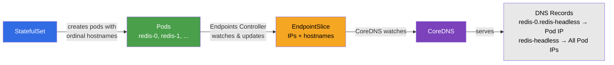

## kubernetes headless services
接下来我们来探究下kubernetes无头服务的工作原理，以及它们与普通ClusterIP服务的区别。无头服务无需使用虚拟IP地址，而是通过直接解析DNS到Pod的IP地址来实现通信。这种通信使得应用程序能够直接在同一集群内的不同Pod之间进行交互，因此对于需要持久化状态管理的应用程序来说，无头服务是非常重要的。

## 概述
在标准的kubernetes服务中，ClusterIP通过kube-proxy和稳定的VIP来实现负载均衡。不过，某些应用场景需要直接访问特定的Pod。
- Stateful Applications(状态化应用程序)：像Redis、MySQL、PostgreSQL、MongoDB 和 Cassandra这样的数据库需要客户端能够连接特定的实例副本(例如：主副本与备副本)
- Peer Discovery: 分布式系统（如kafka, Elasticsearch, etcd等）需要容器之间能够直接发现并相互通信
- Client-Side Load Balancing(): 哪些自己实现负载均衡逻辑的应用程序需要访问所有Pod的IP地址
- Service Mesh integration(服务网格集成)：某些服务网格倾向于直接使用Pod寻址，以实现细粒度的流量控制

| 特性（Feature）                 | ClusterIP 服务（ClusterIP Service） | 无头服务（Headless Service） |
| --------------------------- | ------------------------------- | ---------------------- |
| 虚拟 IP（VIP）                  | 有（`clusterIP: <IP>`）            | 无（`clusterIP: None`）   |
| DNS 解析（DNS Resolution）      | 返回服务 VIP                        | 直接返回 Pod IP            |
| 负载均衡（Load Balancing）        | 由 kube-proxy 处理                 | 由客户端处理或不做负载均衡          |
| iptables 规则（iptables Rules） | 由 kube-proxy 创建                 | 无（没有可做 NAT 的 VIP）      |
| 使用场景（Use Case）              | 通用服务发现                          | 有状态应用、对等节点发现           |

### 无头服务创建的DNS记录
无头服务根据工作负载类型创建不同的DNS记录：
使用StatefulSet时：
- A record: `<service>.<namespace>.svc.cluster.local` → 返回所有 Pod IP
- **每个 Pod 的 A 记录**：`<pod-name>.<service>.<namespace>.svc.cluster.local` → 返回特定 Pod 的 IP
- 示例：`redis-0.redis-headless.default.svc.cluster.local` → Pod IP

使用Deployment/ReplicaSet时：
- **A record**：`<service>.<namespace>.svc.cluster.local` → 返回所有 Pod IP
- 没有单个 Pod 的 DNS 记录（Pod 不具备稳定的身份标识）

## 资源清单

### 网络topo
```yaml
name: headless-services
topology:
  nodes:
    headless-services:
      kind: k8s-kind
      image: kindest/node:v1.35.0
      startup-config: headless-services-no-cni.yaml
      extras:
        k8s_kind:
          deploy:
            wait: 0s
```

### kind集群配置
```yaml
apiVersion: kind.x-k8s.io/v1alpha4
kind: Cluster
networking:
  disableDefaultCNI: true
  podSubnet: "192.168.0.0/16"
  serviceSubnet: "10.96.0.0/16"
nodes:
  - role: control-plane
  - role: worker
  - role: worker
```

### Calico 配置
```yaml
apiVersion: operator.tigera.io/v1
kind: Installation
metadata:
  name: default
spec:
  calicoNetwork:
    ipPools:
    - blockSize: 26
      cidr: 192.168.0.0/16
      encapsulation: VXLANCrossSubnet
      natOutgoing: Enabled
      nodeSelector: all()
---
apiVersion: operator.tigera.io/v1
kind: APIServer
metadata:
  name: default
spec: {}
```

### service配置

无头服务配置
```yaml
# Redis StatefulSet with Headless Service and Replication
# This demonstrates:
# 1. Pod-specific DNS records (redis-0.redis-headless, redis-1.redis-headless, etc.)
# 2. How Redis replicas discover and connect to the master using headless service DNS
# 
# Architecture:
# - redis-0: Master (primary) - accepts writes
# - redis-1, redis-2: Replicas - discover master via redis-0.redis-headless DNS
apiVersion: v1
kind: Service
metadata:
  name: redis-headless
  namespace: default
  labels:
    app: redis
spec:
  ports:
  - port: 6379
    name: redis
  # clusterIP: None makes this a headless service
  clusterIP: None
  selector:
    app: redis
---
apiVersion: apps/v1
kind: StatefulSet
metadata:
  name: redis
  namespace: default
spec:
  # serviceName must match the headless service name for DNS to work
  serviceName: "redis-headless"
  replicas: 3
  selector:
    matchLabels:
      app: redis
  template:
    metadata:
      labels:
        app: redis
    spec:
      terminationGracePeriodSeconds: 10
      initContainers:
      # Init container waits for DNS to be ready for replicas
      # This ensures redis-0 is discoverable before replicas start
      - name: init-redis
        image: redis:7-alpine
        command:
        - /bin/sh
        - -c
        - |
          set -ex
          # Extract pod ordinal from hostname (e.g., redis-0 -> 0)
          ORDINAL=${HOSTNAME##*-}
          
          # If this is a replica (ordinal > 0), wait for master to be available
          if [ "$ORDINAL" != "0" ]; then
            echo "This is replica redis-$ORDINAL, waiting for master redis-0..."
            until redis-cli -h redis-0.redis-headless.default.svc.cluster.local ping; do
              echo "Waiting for redis-0.redis-headless to be ready..."
              sleep 2
            done
            echo "Master redis-0 is ready!"
          else
            echo "This is the master redis-0, no need to wait"
          fi
        resources:
          requests:
            cpu: 10m
            memory: 16Mi
      containers:
      - name: redis
        image: redis:7-alpine
        ports:
        - containerPort: 6379
          name: redis
        resources:
          requests:
            cpu: 50m
            memory: 64Mi
          limits:
            cpu: 200m
            memory: 256Mi
        env:
        - name: POD_NAME
          valueFrom:
            fieldRef:
              fieldPath: metadata.name
        # Redis configuration with dynamic master/replica setup
        # Replicas discover master using headless service DNS: redis-0.redis-headless
        command:
        - /bin/sh
        - -c
        - |
          set -ex
          # Extract pod ordinal from hostname (e.g., redis-0 -> 0)
          ORDINAL=${HOSTNAME##*-}
          
          if [ "$ORDINAL" = "0" ]; then
            # This is the master
            echo "Starting as MASTER (redis-0)"
            exec redis-server \
              --bind 0.0.0.0 \
              --protected-mode no \
              --replica-announce-ip ${POD_NAME}.redis-headless.default.svc.cluster.local
          else
            # This is a replica - connect to master using headless service DNS
            # KEY CONCEPT: Replicas discover master via: redis-0.redis-headless.default.svc.cluster.local
            echo "Starting as REPLICA (redis-$ORDINAL), replicating from redis-0.redis-headless"
            exec redis-server \
              --bind 0.0.0.0 \
              --protected-mode no \
              --replicaof redis-0.redis-headless.default.svc.cluster.local 6379 \
              --replica-announce-ip ${POD_NAME}.redis-headless.default.svc.cluster.local
          fi
        readinessProbe:
          exec:
            command:
            - redis-cli
            - ping
          initialDelaySeconds: 5
          periodSeconds: 5
        livenessProbe:
          exec:
            command:
            - redis-cli
            - ping
          initialDelaySeconds: 15
          periodSeconds: 10
      tolerations:
      - key: node-role.kubernetes.io/control-plane
        operator: Exists
        effect: NoSchedule
      - key: node-role.kubernetes.io/master
        operator: Exists
        effect: NoSchedule
```

deployment类型服务
```yaml
# Deployment with both ClusterIP and Headless Services
# This demonstrates the difference in DNS resolution between the two types
apiVersion: apps/v1
kind: Deployment
metadata:
  name: nginx-deployment
  namespace: default
  labels:
    app: nginx
spec:
  replicas: 2
  selector:
    matchLabels:
      app: nginx
  template:
    metadata:
      labels:
        app: nginx
    spec:
      containers:
      - name: nginx
        image: nginx:stable
        ports:
        - containerPort: 80
        resources:
          requests:
            cpu: 50m
            memory: 64Mi
          limits:
            cpu: 200m
            memory: 256Mi
        lifecycle:
          postStart:
            exec:
              command:
              - /bin/sh
              - -c
              - |
                echo "<html><body><h1>Deployment Pod: $(hostname)</h1><p>IP: $(hostname -i)</p></body></html>" > /usr/share/nginx/html/index.html
---
# Regular ClusterIP Service - for comparison
apiVersion: v1
kind: Service
metadata:
  name: nginx-clusterip
  namespace: default
  labels:
    app: nginx
spec:
  selector:
    app: nginx
  ports:
  - name: http
    port: 80
    targetPort: 80
    protocol: TCP
  # Default type is ClusterIP - gets a VIP
  type: ClusterIP
---
# Headless Service for the same Deployment
apiVersion: v1
kind: Service
metadata:
  name: nginx-headless
  namespace: default
  labels:
    app: nginx
spec:
  selector:
    app: nginx
  ports:
  - name: http
    port: 80
    targetPort: 80
    protocol: TCP
  # clusterIP: None makes this a headless service
  clusterIP: None
```

## 环境检查

### 检查containerlab topo结构
```bash
> containerlab inspect -t headless-services.clab.yaml
22:09:39 INFO Parsing & checking topology file=headless-services.clab.yaml
╭─────────────────────────────────┬──────────────────────┬─────────┬───────────────────────╮
│               Name              │      Kind/Image      │  State  │     IPv4/6 Address    │
├─────────────────────────────────┼──────────────────────┼─────────┼───────────────────────┤
│ headless-services-control-plane │ k8s-kind             │ running │ 172.18.0.3            │
│                                 │ kindest/node:v1.35.0 │         │ fc00:f853:ccd:e793::3 │
├─────────────────────────────────┼──────────────────────┼─────────┼───────────────────────┤
│ headless-services-worker        │ k8s-kind             │ running │ 172.18.0.2            │
│                                 │ kindest/node:v1.35.0 │         │ fc00:f853:ccd:e793::2 │
├─────────────────────────────────┼──────────────────────┼─────────┼───────────────────────┤
│ headless-services-worker2       │ k8s-kind             │ running │ 172.18.0.4            │
│                                 │ kindest/node:v1.35.0 │         │ fc00:f853:ccd:e793::4 │
╰─────────────────────────────────┴──────────────────────┴─────────┴───────────────────────╯
```

### 检查pods和services
查看pod是否都正常运行
```bash
> kubectl get pod -o wide
NAME                                READY   STATUS    RESTARTS   AGE     IP                NODE                              NOMINATED NODE   READINESS GATES
multitool-krrjl                     1/1     Running   0          7m42s   192.168.112.194   headless-services-control-plane   <none>           <none>
multitool-kw6jr                     1/1     Running   0          7m42s   192.168.60.201    headless-services-worker          <none>           <none>
multitool-z2rs2                     1/1     Running   0          7m42s   192.168.140.4     headless-services-worker2         <none>           <none>
nginx-deployment-5cccd4ffd4-s9cf5   1/1     Running   0          7m42s   192.168.140.3     headless-services-worker2         <none>           <none>
nginx-deployment-5cccd4ffd4-v6zrx   1/1     Running   0          7m42s   192.168.60.200    headless-services-worker          <none>           <none>
redis-0                             1/1     Running   0          7m42s   192.168.140.2     headless-services-worker2         <none>           <none>
redis-1                             1/1     Running   0          7m34s   192.168.60.202    headless-services-worker          <none>           <none>
redis-2                             1/1     Running   0          7m25s   192.168.112.195   headless-services-control-plane   <none>           <none>
```

- `redis-0`: Master主节点，主要负责数据复制(接受数据写入操作)，并将数据复制至 `redis-1`和`redis-2`
- `redis-1,redis-2`: 这些服务通过无主服务DNS机制与`redis-0`连接在一起
- `nginx-deployment-*`: 带有随机后缀名的deployment容器
- multitool: 在每个节点上用于测试的容器

```bash
> kubectl get statefulsets.apps
NAME    READY   AGE
redis   3/3     26m
```
- 可以看到 `READY: 3/3` 说明 redis statefulSet的所有3个实例都已经运行
- StatefulSet确保Pod按照顺序排列创建(redis-0->redis-1->redis-2)，并维持了稳定的身份标识。

```bash
> kubectl get svc
NAME              TYPE        CLUSTER-IP     EXTERNAL-IP   PORT(S)    AGE
kubernetes        ClusterIP   10.96.0.1      <none>        443/TCP    29m
nginx-clusterip   ClusterIP   10.96.10.236   <none>        80/TCP     26m
nginx-headless    ClusterIP   None           <none>        80/TCP     26m
redis-headless    ClusterIP   None           <none>        6379/TCP   26m
```

- `nginx-clusterip`: 具有VIP的常规ClusterIP服务。
- `nginx-headless`: 用于Deployment类型服务的无头服务(`ClusterIP: None`)
- `redis-headless`: 适用于statefulSet类型服务的无头服务(`ClusterIP: None`)

## 对比 ClusterIP 和 Headless Service 的 DNS解析方式
进入到multitool来进行DNS解析功能测试

```bash
> kubectl get pods -l app=multitool -o wide
NAME              READY   STATUS    RESTARTS   AGE   IP                NODE                              NOMINATED NODE   READINESS GATES
multitool-krrjl   1/1     Running   0          39m   192.168.112.194   headless-services-control-plane   <none>           <none>
multitool-kw6jr   1/1     Running   0          39m   192.168.60.201    headless-services-worker          <none>           <none>
multitool-z2rs2   1/1     Running   0          39m   192.168.140.4     headless-services-worker2         <none>           <none>
> kubectl exec -it multitool-krrjl -- sh
/ # 
```

### 常规ClusterIP服务的DNS

```bash
> kubectl exec -it multitool-krrjl -- sh
/ # dig +search nginx-clusterip

; <<>> DiG 9.16.20 <<>> +search nginx-clusterip
;; global options: +cmd
;; Got answer:
;; WARNING: .local is reserved for Multicast DNS
;; You are currently testing what happens when an mDNS query is leaked to DNS
;; ->>HEADER<<- opcode: QUERY, status: NOERROR, id: 63103
;; flags: qr aa rd; QUERY: 1, ANSWER: 1, AUTHORITY: 0, ADDITIONAL: 1
;; WARNING: recursion requested but not available

;; OPT PSEUDOSECTION:
; EDNS: version: 0, flags:; udp: 4096
; COOKIE: 7f8ed760a0f79e51 (echoed)
;; QUESTION SECTION:
;nginx-clusterip.default.svc.cluster.local. IN A

;; ANSWER SECTION:
nginx-clusterip.default.svc.cluster.local. 30 IN A 10.96.10.236

;; Query time: 42 msec
;; SERVER: 10.96.0.10#53(10.96.0.10)
;; WHEN: Tue Oct 13 14:44:14 UTC 2026
;; MSG SIZE  rcvd: 139

```

- 返回VIP地址(`10.96.10.236`)
- kube-proxy负责将负载均衡到后端容器
- 无论副本数量多少，客户端只能看到一个IP地址

### headless service DNS(Deployment)

```bash
> kubectl exec -it multitool-8fkwf -- sh
/ # dig +search nginx-headless

; <<>> DiG 9.16.20 <<>> +search nginx-headless
;; global options: +cmd
;; Got answer:
;; WARNING: .local is reserved for Multicast DNS
;; You are currently testing what happens when an mDNS query is leaked to DNS
;; ->>HEADER<<- opcode: QUERY, status: NOERROR, id: 17392
;; flags: qr aa rd; QUERY: 1, ANSWER: 2, AUTHORITY: 0, ADDITIONAL: 1
;; WARNING: recursion requested but not available

;; OPT PSEUDOSECTION:
; EDNS: version: 0, flags:; udp: 4096
; COOKIE: 0e1b498a6ce36cf9 (echoed)
;; QUESTION SECTION:
;nginx-headless.default.svc.cluster.local. IN A

;; ANSWER SECTION:
nginx-headless.default.svc.cluster.local. 30 IN A 192.168.60.194
nginx-headless.default.svc.cluster.local. 30 IN A 192.168.140.8

;; Query time: 2 msec
;; SERVER: 10.96.0.10#53(10.96.0.10)
;; WHEN: Wed Oct 14 03:29:31 UTC 2026
;; MSG SIZE  rcvd: 193

```
- 根据DNS解析结果可以看出，直接返回了所有Pod IP地址(no VIP)
- 客户端收到了多个A记录
- 客户端根据需要选择一个IP地址进行通讯，自行及进行负载均衡或者选择操作
- 没有为此服务创建iptables/IPVS规则

### Headless Service DNS(Redis StatefulSet)
```bash
/ # dig +search redis-headless

; <<>> DiG 9.16.20 <<>> +search redis-headless
;; global options: +cmd
;; Got answer:
;; WARNING: .local is reserved for Multicast DNS
;; You are currently testing what happens when an mDNS query is leaked to DNS
;; ->>HEADER<<- opcode: QUERY, status: NOERROR, id: 48707
;; flags: qr aa rd; QUERY: 1, ANSWER: 3, AUTHORITY: 0, ADDITIONAL: 1
;; WARNING: recursion requested but not available

;; OPT PSEUDOSECTION:
; EDNS: version: 0, flags:; udp: 4096
; COOKIE: 51566544fb374c36 (echoed)
;; QUESTION SECTION:
;redis-headless.default.svc.cluster.local. IN A

;; ANSWER SECTION:
redis-headless.default.svc.cluster.local. 30 IN A 192.168.60.195
redis-headless.default.svc.cluster.local. 30 IN A 192.168.112.195
redis-headless.default.svc.cluster.local. 30 IN A 192.168.140.10

;; Query time: 0 msec
;; SERVER: 10.96.0.10#53(10.96.0.10)
;; WHEN: Wed Oct 14 03:33:27 UTC 2026
;; MSG SIZE  rcvd: 249
```

- 返回所有Redis的Pod IP地址
- 每个Pod都有一个稳定的网络身份

## Redis 单个 Pod的DNS记录
无头服务与StatefulSet结合使用的关键优势，在于单个Pod的DNS记录。这对于需要连接特定实例（例如：主从节点）的数据库至关重要。

### StatefulSet与Ordinals(序号)的工作机制
与使用随机后缀常见Pod的Deployment不同，StatefulSet使用从0起始的序号(Ordinal index)为每个Pod分配一个稳定、可预测的身份标识。当你创建一个名为redis、含3个副本的StatefulSet时：
- Pod按照顺序创建：先redis-0, 然后redis-1最后redis-2。
- Pod按照相反顺序删除：先删除redis-2，再删除redis-1，最后删除redis-0
- 每个Pod的hostname与其名称一致(例如redis-0)
- 可以从主机名中提取0,1,2来确定Pod的角色
这种顺序对于分布式系统至关重要
- Promary election: redis-0由于最先启动，始终可以被指定为主节点。
- Ordered startup: 从节点在连接到当前会等待主节点就绪
- Graceful scaling(优雅扩缩容)：扩缩容时，序号最高的Pod会被先移除

结合我投服务每个Pod都会获得一个唯一的DNS名称 `<pod-name>.<service-name>.<namespace>.svc.cluster.local`。这使得Pod之间能够按名称发现并寻址对方，从而支持复制、集群组件和主节点选举等对等通信。

### CoreDNS如何为StatefulSet创建DNS记录
当创建带无头服务的StatefulSet时，Kubernetes与CoreDNS协同创建DNS记录：
1. StatefulSet控制器创建带有序号名称的Pod(redis-0,redis-1,redis-2)
2. Endpoints控制器监视与无头服务选择器匹配的Pod，并创建/更新EndpointSlice资源
3. EndpointSlice包含Pod的IP、端口，以及对StatefulSet而言尤为重要的每个Pod的hostname(主机名)和nodename(节点名)
4. CoreDNS能够监控EndpointSlice中的资源，并自动生成相应的DNS 记录
	- 对于该服务 `redis-headless.defautl.svc.cluster.local` -> 所有Pod的IP地址 (A record)
	- 对于每个Pod: `redis-0.redis-headless.defautl.svc.cluster.local` -> 具体的Pod IP地址
与常规服务不同的是，CoreDNS在EndpointSlice中使用hostname字段来创建每个Pod的DNS记录。这个字段只有在Pod拥有hostname时才会被填充。

### 什么是EndpointSlice
EndpointSlice是kubernetes中的一个资源，用于跟踪某个服务的网络端点(包括IP地址和端口)。它作为这一种更可扩展的替代方案，取代了旧的Endpoints资源。主要特性包括：
- 自动创建：Kubernetes 会自动为每个服务创建并管理 EndpointSlice。
- Pod 跟踪：包含所有与服务选择器匹配的 Pod 的 IP 地址。
- 可扩展性：与 Endpoints（仅限于~1000 个端点）不同，EndpointSlices 可以分布在多个对象上，从而适用于大型服务场景。
- 丰富的元数据：包含诸如 `hostname` 、 `nodeName` 、 `zone` 等附加信息，以及设备准备状态等数据。
- 消费者：CoreDNS 和 kube-proxy 负责监控 EndpointSlice，分别用于构建 DNS 记录和 iptables/IPVS 规则
对于无头服务来说，CoreDNS 会读取 EndpointSlice 中的数据，然后使用 Pod 的 IP 地址直接响应 DNS 查询（而不是使用服务的 VIP 地址）。

确认无头服务的EndpointSlices功能已生效
```bash
> kubectl get endpointslice -l kubernetes.io/service-name=redis-headless -o yaml
apiVersion: v1
items:
- addressType: IPv4
  apiVersion: discovery.k8s.io/v1
  endpoints:
  - addresses:
    - 192.168.60.195
    conditions:
      ready: true
      serving: true
      terminating: false
    hostname: redis-0
    nodeName: headless-services-worker
    targetRef:
      kind: Pod
      name: redis-0
      namespace: default
      uid: 77404e8b-13fe-4018-900f-167a859b81c2
  - addresses:
    - 192.168.112.195
    conditions:
      ready: true
      serving: true
      terminating: false
    hostname: redis-1
    nodeName: headless-services-control-plane
    targetRef:
      kind: Pod
      name: redis-1
      namespace: default
      uid: e194d1e5-931f-46fa-8d4c-abc0334fc47f
  - addresses:
    - 192.168.140.10
    conditions:
      ready: true
      serving: true
      terminating: false
    hostname: redis-2
    nodeName: headless-services-worker2
    targetRef:
      kind: Pod
      name: redis-2
      namespace: default
      uid: 3bf88b60-fd17-4701-b7f8-571b04898a46
  kind: EndpointSlice
  metadata:
    annotations:
      endpoints.kubernetes.io/last-change-trigger-time: "2026-10-13T11:54:08Z"
    creationTimestamp: "2026-10-13T11:53:05Z"
    generateName: redis-headless-
    generation: 7
    labels:
      app: redis
      endpointslice.kubernetes.io/managed-by: endpointslice-controller.k8s.io
      kubernetes.io/service-name: redis-headless
      service.kubernetes.io/headless: ""
    name: redis-headless-vss6k
    namespace: default
    ownerReferences:
    - apiVersion: v1
      blockOwnerDeletion: true
      controller: true
      kind: Service
      name: redis-headless
      uid: c84d5d18-be89-4fa0-87f1-d258175b19fb
    resourceVersion: "2724"
    uid: d5d16e95-1a86-4b91-b328-1f431528671c
  ports:
  - name: redis
    port: 6379
    protocol: TCP
kind: List
metadata:
  resourceVersion: ""
```
请注意每个端点中的 `hostname` 字段——这正是 CoreDNS 用来创建 `redis-0.redis-headless` 这类单个 Pod DNS 记录的依据。

```bash
> kubectl get endpointslice -l kubernetes.io/service-name=nginx-headless -o yaml
apiVersion: v1
items:
- addressType: IPv4
  apiVersion: discovery.k8s.io/v1
  endpoints:
  - addresses:
    - 192.168.140.8
    conditions:
      ready: true
      serving: true
      terminating: false
    nodeName: headless-services-worker2
    targetRef:
      kind: Pod
      name: nginx-deployment-5cccd4ffd4-brqn8
      namespace: default
      uid: 90e595b8-627a-4823-9432-e8828cad80fa
  - addresses:
    - 192.168.60.194
    conditions:
      ready: true
      serving: true
      terminating: false
    nodeName: headless-services-worker
    targetRef:
      kind: Pod
      name: nginx-deployment-5cccd4ffd4-cx5nm
      namespace: default
      uid: 99c23bb9-d2eb-4fcf-88b3-260c7afe7680
  kind: EndpointSlice
  metadata:
    annotations:
      endpoints.kubernetes.io/last-change-trigger-time: "2026-10-13T11:53:21Z"
    creationTimestamp: "2026-10-13T11:53:10Z"
    generateName: nginx-headless-
    generation: 3
    labels:
      app: nginx
      endpointslice.kubernetes.io/managed-by: endpointslice-controller.k8s.io
      kubernetes.io/service-name: nginx-headless
      service.kubernetes.io/headless: ""
    name: nginx-headless-pmmhw
    namespace: default
    ownerReferences:
    - apiVersion: v1
      blockOwnerDeletion: true
      controller: true
      kind: Service
      name: nginx-headless
      uid: f3b3784a-2db8-4420-921c-aab5b6b7a87e
    resourceVersion: "2572"
    uid: 75c1b7db-c3ed-4af4-af55-64f1a903e3c4
  ports:
  - name: http
    port: 80
    protocol: TCP
kind: List
metadata:
  resourceVersion: ""
```

请注意，Deployment 的 EndpointSlice 中**没有 `hostname` 字段**——这就是为什么 Deployment 的 Pod 无法像 StatefulSet 的 Pod 那样获得单个 DNS 记录。



| 组件（Component）              | 作用（Role）                              |
| -------------------------- | ------------------------------------- |
| **StatefulSet 控制器**        | 创建带有稳定主机名的 Pod（`redis-0`、`redis-1` 等） |
| **无头服务（Headless Service）** | 定义选择器，并告知 Kubernetes 不分配 ClusterIP    |
| **Endpoints 控制器**          | 创建带 Pod IP 和主机名的 EndpointSlice        |
| **EndpointSlice**          | 存储 Pod 地址、端口和主机名，供 CoreDNS 使用         |
| **CoreDNS**                | 监视 EndpointSlice，并以 Pod 特定记录响应 DNS 查询 |
|                            |                                       |

### 查询单个Pod的DNS

```bash
/ # dig +search redis-0.redis-headless

; <<>> DiG 9.16.20 <<>> +search redis-0.redis-headless
;; global options: +cmd
;; Got answer:
;; WARNING: .local is reserved for Multicast DNS
;; You are currently testing what happens when an mDNS query is leaked to DNS
;; ->>HEADER<<- opcode: QUERY, status: NOERROR, id: 27021
;; flags: qr aa rd; QUERY: 1, ANSWER: 1, AUTHORITY: 0, ADDITIONAL: 1
;; WARNING: recursion requested but not available

;; OPT PSEUDOSECTION:
; EDNS: version: 0, flags:; udp: 4096
; COOKIE: 9082d503e347a94e (echoed)
;; QUESTION SECTION:
;redis-0.redis-headless.default.svc.cluster.local. IN A

;; ANSWER SECTION:
redis-0.redis-headless.default.svc.cluster.local. 30 IN A 192.168.60.195

;; Query time: 0 msec
;; SERVER: 10.96.0.10#53(10.96.0.10)
;; WHEN: Wed Oct 14 05:30:21 UTC 2026
;; MSG SIZE  rcvd: 153
```

- `redis-0.redis-headless` 能解析到 `redis-0` 的特定IP
- 支持直接连接特定的Redis示例

### 测试特定redis实例的连通性

```bash
# 使用DNS名称连接到redis-0
/ # redis-cli -h redis-0.redis-headless ping
PONG
```
- 通过DNS名称直接连接到 redis-0
- 对于数据库主/从节点的选择至关重要

## 通过无头服务DNS实现Redis replication
Redis从节点(redis-1,redis-2)通过无头服务DNS名称 `redis-0.redis-headless`自动发现并连接到主节点(redis-0)。
### 验证主节点上 replication 的状态
```bash
> kubectl exec -it multitool-8fkwf -- sh
/ # redis-cli -h redis-0.redis-headless INFO replication
# Replication
role:master
connected_slaves:2
slave0:ip=redis-1.redis-headless.default.svc.cluster.local,port=6379,state=online,offset=93534,lag=0
slave1:ip=redis-2.redis-headless.default.svc.cluster.local,port=6379,state=online,offset=93534,lag=0
master_failover_state:no-failover
master_replid:c0d68252c3af09538df8ad5d90a888d07bff3dfc
master_replid2:0000000000000000000000000000000000000000
master_repl_offset:93534
second_repl_offset:-1
repl_backlog_active:1
repl_backlog_size:1048576
repl_backlog_first_byte_offset:1
repl_backlog_histlen:93534
/ # 
```
- `role:master` - redis-0 是主节点
- `connected_clave:2`: 两个副本已连接
- `slave0` 和 `slave1`分别显示了已连接的复制实例的IP地址以及它们的同步状态

### 验证副本的状态
```bash
/ # redis-cli -h redis-1.redis-headless INFO replication
# Replication
# 这是一个复制品
role:slave
# 复制器通过无头服务找到了主节点
master_host:redis-0.redis-headless.default.svc.cluster.local
master_port:6379
# 已成功连接到主设备
master_link_status:up
master_last_io_seconds_ago:9
master_sync_in_progress:0
slave_read_repl_offset:93814
slave_repl_offset:93814
slave_priority:100
# 副本处于只读模式
slave_read_only:1
replica_announced:1
connected_slaves:0
master_failover_state:no-failover
master_replid:c0d68252c3af09538df8ad5d90a888d07bff3dfc
master_replid2:0000000000000000000000000000000000000000
master_repl_offset:93814
second_repl_offset:-1
repl_backlog_active:1
repl_backlog_size:1048576
repl_backlog_first_byte_offset:15
repl_backlog_histlen:93800
```

### 测试数据复制
```bash
/ # redis-cli -h redis-0.redis-headless SET mykey "Hello from master"
OK
/ # redis-cli -h redis-1.redis-headless GET mykey
"Hello from master"
/ # 
/ # redis-cli -h redis-2.redis-headless GET mykey
"Hello from master"
```
- 写入主节点的数据会自动复制到其它所有副本上
- 副本通过 `redis-0.redis-headless` DNS名称找到主节点

### 验证副本只读
```bash
/ # redis-cli -h redis-1.redis-headless SET anotherkey "test"
(error) READONLY You can't write against a read only replica.
/ # 
```
- 副本默认情况下是只读的
- 所有的写操作都必须提交到主节点

### 节点发现机制的工作原理
我们通过日志可以查看副本是如何找到主节点的
```bash
> kubectl logs redis-1
Defaulted container "redis" out of: redis, init-redis (init)
+ ORDINAL=1
+ '[' 1 '=' 0 ]
+ echo 'Starting as REPLICA (redis-1), replicating from redis-0.redis-headless'
+ exec redis-server --bind 0.0.0.0 --protected-mode no --replicaof redis-0.redis-headless.default.svc.cluster.local 6379 --replica-announce-ip redis-1.redis-headless.default.svc.cluster.local
Starting as REPLICA (redis-1), replicating from redis-0.redis-headless
1:C 13 Oct 2026 11:53:47.442 * oO0OoO0OoO0Oo Redis is starting oO0OoO0OoO0Oo
1:C 13 Oct 2026 11:53:47.442 * Redis version=7.4.11, bits=64, commit=00000000, modified=0, pid=1, just started
1:C 13 Oct 2026 11:53:47.442 * Configuration loaded
1:S 13 Oct 2026 11:53:47.442 * monotonic clock: POSIX clock_gettime
1:S 13 Oct 2026 11:53:47.443 * Running mode=standalone, port=6379.
1:S 13 Oct 2026 11:53:47.443 * Server initialized
1:S 13 Oct 2026 11:53:47.443 * Ready to accept connections tcp
1:S 13 Oct 2026 11:53:47.443 * Connecting to MASTER redis-0.redis-headless.default.svc.cluster.local:6379
1:S 13 Oct 2026 11:53:47.444 * MASTER <-> REPLICA sync started
1:S 13 Oct 2026 11:53:47.444 * Non blocking connect for SYNC fired the event.
1:S 13 Oct 2026 11:53:47.444 * Master replied to PING, replication can continue...
1:S 13 Oct 2026 11:53:47.444 * Partial resynchronization not possible (no cached master)
1:S 13 Oct 2026 11:53:52.064 * Full resync from master: c0d68252c3af09538df8ad5d90a888d07bff3dfc:14
1:S 13 Oct 2026 11:53:52.065 * MASTER <-> REPLICA sync: receiving streamed RDB from master with EOF to disk
1:S 13 Oct 2026 11:53:52.065 * MASTER <-> REPLICA sync: Flushing old data
1:S 13 Oct 2026 11:53:52.065 * MASTER <-> REPLICA sync: Loading DB in memory
1:S 13 Oct 2026 11:53:52.253 * Loading RDB produced by version 7.4.11
1:S 13 Oct 2026 11:53:52.253 * RDB age 0 seconds
1:S 13 Oct 2026 11:53:52.253 * RDB memory usage when created 1.00 Mb
1:S 13 Oct 2026 11:53:52.253 * Done loading RDB, keys loaded: 0, keys expired: 0.
1:S 13 Oct 2026 11:53:52.253 * MASTER <-> REPLICA sync: Finished with success
1:S 14 Oct 2026 06:41:01.161 * 1 changes in 3600 seconds. Saving...
1:S 14 Oct 2026 06:41:01.161 * Background saving started by pid 121505
121505:C 14 Oct 2026 06:41:01.300 * DB saved on disk
121505:C 14 Oct 2026 06:41:01.301 * Fork CoW for RDB: current 0 MB, peak 0 MB, average 0 MB
1:S 14 Oct 2026 06:41:01.362 * Background saving terminated with success
```

- init container 初始化容器通过DNS等待主节点可用
- 从节点以 `--replicaof redis-0.redis-headless.default.svc.cluster.local 6379` 启动。
- Redis 使用无头服务的 DNS 名称连接到主节点。
- 从主节点向从节点发起全量同步


## 验证无头服务有没有iptables规则
### 检查 ClusterIP 服务的 iptables 规则
```bash
> docker exec -it headless-services-worker /bin/bash
root@headless-services-worker:/# iptables -t nat -S KUBE-SERVICES | grep nginx-clusterip
-A KUBE-SERVICES -d 10.96.59.40/32 -p tcp -m comment --comment "default/nginx-clusterip:http cluster IP" -m tcp --dport 80 -j KUBE-SVC-VS7JYC4FNXA3J2IX
```

- ClusterIP服务存在iptables规则
- kube-proxy为负载均衡编写 DNAT规则

### 检查无头服务的 iptables 规则

```bash
root@headless-services-worker:/# iptables -t nat -S KUBE-SERVICES | grep nginx-headless
root@headless-services-worker:/# 
root@headless-services-worker:/# iptables -t nat -S KUBE-SERVICES | grep redis-headless
root@headless-services-worker:/# 
```

- 无头服务没有iptables规则
- 没有可供NAT流量的VIP
- DNS直接返回Pod IP；路由使用正常的Pod 路由

## 总结
|方面（Aspect）|ClusterIP 服务（ClusterIP Service）|无头服务（Headless Service）|
|---|---|---|
|DNS 响应（DNS Response）|服务 VIP|所有 Pod IP|
|负载均衡（Load Balancing）|kube-proxy（iptables/IPVS）|由客户端处理|
|iptables 规则（iptables Rules）|有|无|
|Pod 特定 DNS（Pod-specific DNS）|无|有（与 StatefulSet 结合时）|
|使用场景（Use Case）|通用服务|有状态应用、对等节点发现|
- **Headless services** (`clusterIP: None`) bypass kube-proxy entirely
  **无头服务**（`clusterIP: None`）完全绕过了 kube-proxy。
- DNS returns **pod IPs directly** instead of a VIP
  DNS 直接返回 **Pod IP**，而不是 VIP。
- **StatefulSets** with headless services get individual pod DNS records (`<pod>.<service>.<ns>.svc.cluster.local`)
  与无头服务结合使用的 **StatefulSet** 会获得单个 Pod 的 DNS 记录（`<pod>.<service>.<ns>.svc.cluster.local`）。
- **No iptables rules** are created for headless services
  不会为无头服务创建 **iptables 规则**。
- Essential for **databases like Redis** requiring direct pod addressing and peer discovery
  对于需要直接 Pod 寻址和对等节点发现的 **Redis 等数据库**至关重要。
- **Redis replicas discover the master** using headless service DNS (`redis-0.redis-headless`)
  **Redis 从节点**通过无头服务 DNS（`redis-0.redis-headless`）**发现主节点**。

## Additional Notes（补充说明）

### Headless Service Gotchas（无头服务的注意事项）
- **No load balancing by default（默认不做负载均衡）**: DNS returns all IPs; client must handle selection DNS 返回所有 IP；客户端必须自行处理选择。
- **DNS caching（DNS 缓存）**: Clients may cache DNS responses; TTL is typically 30 seconds 客户端可能会缓存 DNS 响应；TTL 通常为 30 秒。
- **Pod churn（Pod 更替）**: As pods restart, IPs change; clients should re-resolve DNS periodically 随着 Pod 重启，IP 会发生变化；客户端应定期重新解析 DNS。
- **Not for general services（不适用于通用服务）**: Use ClusterIP for stateless services that benefit from kube-proxy load balancing 对于可从 kube-proxy 负载均衡获益的无状态服务，应使用 ClusterIP。

### DNS Record Types（DNS 记录类型）

- **A Record（A 记录）**: Returns IPv4 addresses 返回 IPv4 地址。
- **AAAA Record（AAAA 记录）**: Returns IPv6 addresses (in dual-stack clusters) 返回 IPv6 地址（在双栈集群中）。
- **SRV Record（SRV 记录）**: Returns port and hostname (use `dig SRV _redis._tcp.redis-headless.default.svc.cluster.local`) 返回端口和主机名（使用 `dig SRV _redis._tcp.redis-headless.default.svc.cluster.local`）。

### When to Use Headless Services（何时使用无头服务）
1. **StatefulSets**: Always pair with headless services for stable network identities **StatefulSet**：始终与无头服务搭配使用，以获得稳定的网络身份标识。
2. **Database Clusters（数据库集群）**: Redis, MySQL, PostgreSQL, MongoDB, Cassandra Redis、MySQL、PostgreSQL、MongoDB、Cassandra。
3. **Distributed Systems（分布式系统）**: Kafka, Elasticsearch, etcd, ZooKeeper Kafka、Elasticsearch、etcd、ZooKeeper。
4. **Custom Load Balancing（自定义负载均衡）**: When clients implement their own balancing logic 当客户端自行实现均衡逻辑时。
5. **Service Mesh（服务网格）**: Some meshes prefer direct pod addressing 某些网格倾向于直接使用 Pod 寻址。


